## Лабораторная работа 3 — Платформа для shop

Цель работы — развернуть приложение `shop` в Kubernetes, ограничить допустимые конфигурации политиками, проверить reconciliation, передать управление PostgreSQL оператору и исследовать поведение приложения при недоступности API-сервера.

Работа выполнена в WSL Ubuntu с Docker Desktop и локальным кластером kind `labs`. В кластере два узла: `labs-control-plane` и `labs-worker`. Для команд Kubernetes используется контекст `kind-labs`, приложение размещено в namespace `shop`. Мониторинг использует ранее настроенный стек из лабораторной 2.

### Структура решения

| Каталог | Назначение |
| --- | --- |
| [shop-services](../shop-services/) | Исходники API и worker, Dockerfile, зависимости Go |
| [policies](../policies/) | Политики Audit/Enforce, допустимый пример и пять нарушающих манифестов |
| [shop-chart](../shop-chart/) | Deployment, Service, PostgreSQL Cluster, ServiceMonitor и PrometheusRule |
| [infra](../infra/) | Настройки kind, операторов, мониторинга и исправления инфраструктурных компонентов |
| [part2-guide](part2-guide/) | Вспомогательные команды миграции, нагрузки и изменения values |
| [screenshots](screenshots/) | Скриншоты выполнения работы |
| [evidence](evidence/) | Сохранённые текстовые результаты экспериментов |

### Подготовка стенда

Создал кластер kind с двумя узлами. Первоначально порт 8080 на хосте оказался недоступен для проброса Docker; заменил его на 18080. В конфигурации сохранено соответствие `18080 → 30080`. Для учебного стенда снял `NoSchedule` taint с control-plane, разрешив размещение рабочих Pod на обоих узлах.

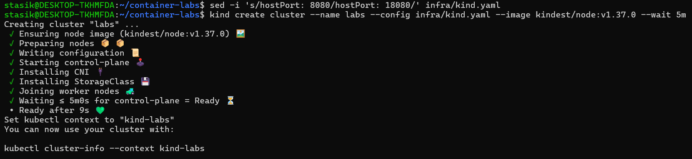
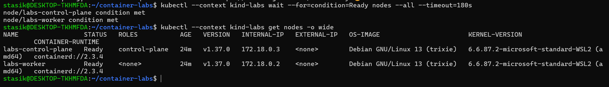
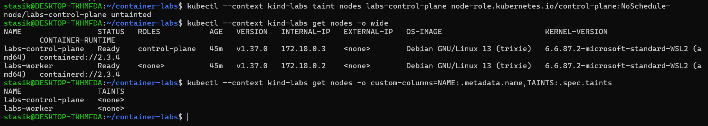

### Часть 0. Сервисы

Подготовлены два сервиса на Go:

- `api`: `GET /health`, `POST /order`, `GET /orders`, `/metrics`; при `HEALTH_FAIL=true` проверка `/health` возвращает 503. Для экспериментов с мониторингом доступны `/fail` и `/slow`.
- `worker`: читает необработанные заказы из PostgreSQL и переводит их в `processed`; предоставляет `/health` и `/metrics`.

Подключение к базе передаётся через `DATABASE_URL` из Kubernetes Secret. Пароли в репозитории не хранятся. Для работы нескольких worker выборка заказов выполняется в транзакции с блокировкой строк и `SKIP LOCKED`.

Исходники и сборка: [API](../shop-services/api/), [worker](../shop-services/worker/). Образы собраны локально и загружены в оба узла kind:

```bash
kind load docker-image docker.io/library/shop-api:v1 \
  docker.io/library/shop-worker:v1 --name labs
```

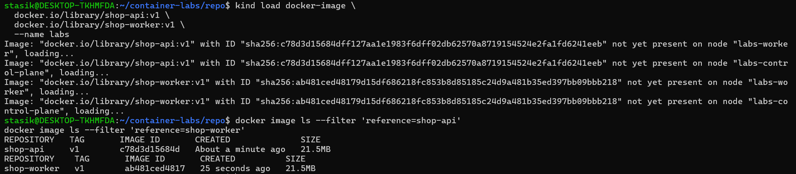

### Часть 1. Ограждения кластера

Выбрал **Kyverno**: правила описываются Kubernetes-манифестами YAML, поэтому не требуется отдельный язык Rego. Для локальной лаборатории удобно хранить правила рядом с чартом, сначала оценивать нарушения в Audit, затем включать Enforce. Admission webhook проверяет запросы на создание и изменение ресурсов; background scan помогает найти нарушения в уже существующих объектах.

Kyverno установлен до развёртывания `shop`. Использована версия чарта 3.9.1, версия Kyverno v1.19.1. Политики используют `ClusterPolicy`; предупреждение об устаревании API зафиксировано, но в установленной версии правила работают.

| Правило | Требование и польза | Проверочный манифест |
| --- | --- | --- |
| `lab3-require-resources` | CPU и memory в requests и limits: планировщик учитывает потребности, ресурсы контейнера ограничены | [01-resources.yaml](../policies/violations/01-resources.yaml) |
| `lab3-trusted-registries` | Образ соответствует разрешённому пути или явно разрешённому старому образу: ограничивается источник образов | [02-registries.yaml](../policies/violations/02-registries.yaml) |
| `lab3-require-labels` | Нужна хотя бы одна непустая идентифицирующая метка: `app`, `app.kubernetes.io/name`, `k8s-app` или `component` | [03-labels.yaml](../policies/violations/03-labels.yaml) |
| `lab3-deny-privileged` | Запрет privileged-контейнеров: сокращается доступ контейнера к возможностям хоста | [04-privileged.yaml](../policies/violations/04-privileged.yaml) |
| `lab3-readonly-rootfs` | `readOnlyRootFilesystem: true`: приложение не изменяет корневую файловую систему; запись переносится в явные тома | [05-readonly.yaml](../policies/violations/05-readonly.yaml) |

Разрешены пути `docker.io/*`, `ghcr.io/*`, `quay.io/*`, `registry.k8s.io/*`, `reg.kyverno.io/kyverno/*`. Для ранее развёрнутого стенда оставлены точные исключения `api-multi:latest` и `jaegertracing/jaeger:2.21.0`. Это проверка источника, а не подписи образа: разрешение всего публичного реестра само по себе не гарантирует доверие к его содержимому.

Политики действуют на кластер с документированными исключениями для системных компонентов:

- для resources исключены четыре статических Pod control plane: etcd, apiserver, controller-manager и scheduler на `labs-control-plane`;
- для privileged исключены `kube-proxy-*` только в `kube-system`;
- для read-only rootfs исключены указанные статические Pod, `kindnet-*` и `kube-proxy-*` в `kube-system`, а также helper Pod `helper-pod-create-pvc-*` и `helper-pod-delete-pvc-*` в `local-path-storage`.

Исключения нужны для совместимости инфраструктуры учебного стенда. Для helper Pod ограничена область исключения по namespace и имени; остальные политики продолжают применяться. Это не доказательство того, что каждому из этих компонентов обязательно нужен записываемый rootfs. Доступ к системным namespace должен ограничиваться RBAC. Именные исключения также ограничивают автоматическую генерацию правил для контроллеров; проверку собственных шаблонов дополнительно выполнял на уровне Pod.

Перед включением Enforce добавил resources инфраструктурным workload, а для нуждающихся в записи компонентов использовал отдельные тома. Настройки сохранены в `infra`, а не только изменены в работающих Pod.

Для каждого негативного примера выполнил серверную проверку:

```bash
kubectl --context kind-labs create --dry-run=server \
  -f policies/examples/valid-pod.yaml
kubectl --context kind-labs create --dry-run=server \
  -f policies/violations/01-resources.yaml
```

Серверный dry-run проходит admission-проверки, но не сохраняет Pod. Допустимый пример принят; каждый из пяти нарушающих примеров отклонён соответствующим правилом.

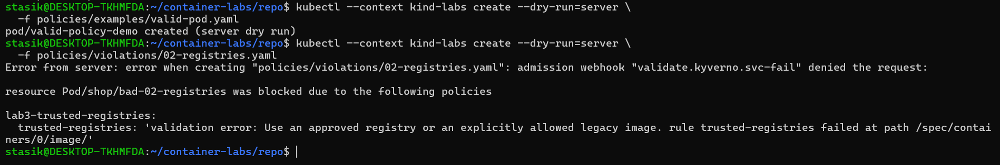
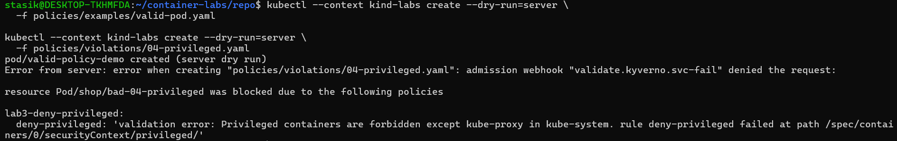
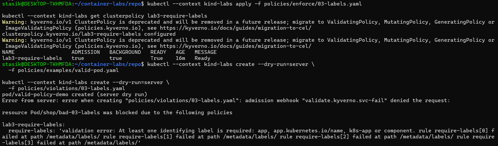
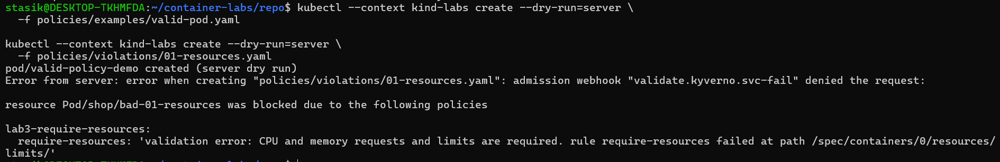
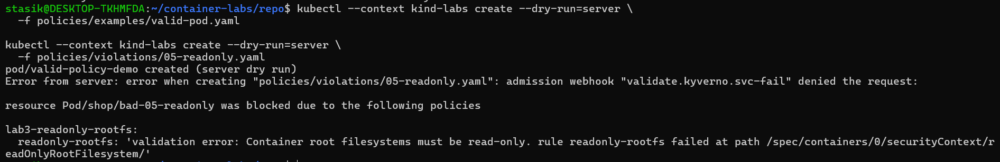

### Часть 2. Helm-чарт API и worker

Созданы [Chart.yaml](../shop-chart/Chart.yaml), [values.yaml](../shop-chart/values.yaml) и [шаблоны](../shop-chart/templates/). Число реплик берётся из values: API — 3, worker — 2. Для обоих заданы readiness- и liveness-пробы на `/health`, resources, метки и securityContext, соответствующие политикам.

Сначала проверил чарт через `helm lint`, рендеринг и server dry-run. Дополнительно извлёк PodSpec из Deployment и проверил отдельные Pod через admission.

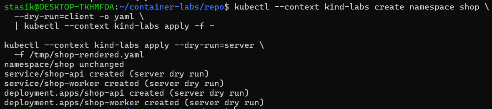
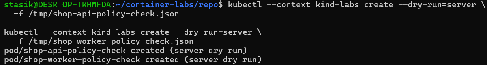

На этапе части 2 использовалась временная PostgreSQL с emptyDir. Схема создана отдельным Job `shop-migrate-v1`. Затем чарт установлен в namespace `shop`:

```bash
helm upgrade --install shop ./shop-chart \
  --kube-context kind-labs --namespace shop --wait --timeout 5m
```

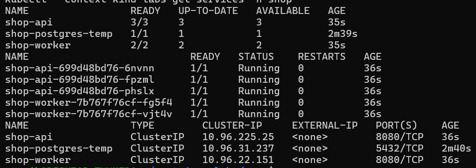
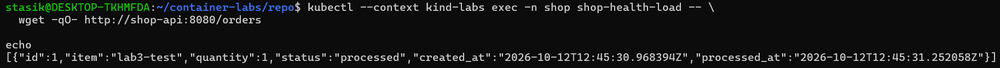

#### Reconciliation

Удалил `shop-api-699d48bd76-6nvnn`. ReplicaSet создал новый Pod `shop-api-699d48bd76-9ss2p`, после чего Deployment снова имел 3 готовые реплики. Императивное удаление Pod не изменило желаемое число реплик в Deployment.

Изменил `api.replicas` с 3 на 4 в values и выполнил `helm upgrade`: число готовых реплик стало 4. Вернул значение 3 и повторил обновление: Deployment вернулся к 3/3.

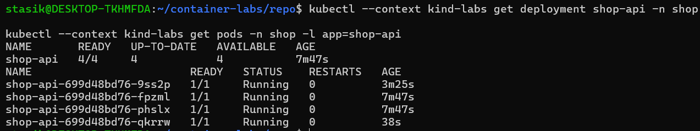
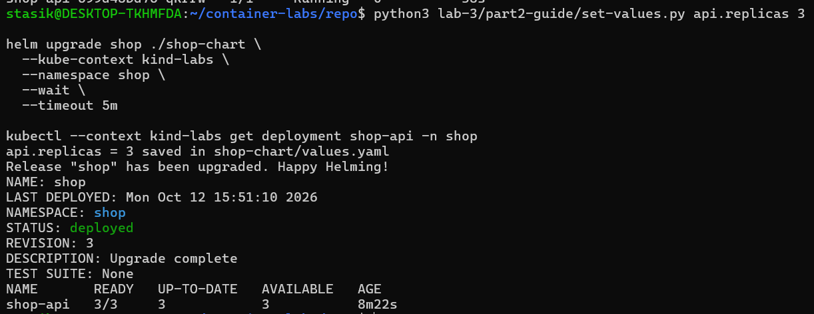

#### Rolling update

Обновил образ API с `v1` на `v2`. Стратегия `maxUnavailable: 0`, `maxSurge: 1` позволяет сначала подготовить дополнительный Pod и затем удалить старый. Readiness определяет готовность нового экземпляра обслуживать трафик; `minReadySeconds` даёт время подтвердить устойчивую готовность.

Во время обновления непрерывно запрашивал `/health` и наблюдал за Pod. Новые Pod становились Ready до удаления старых; обновление не останавливало все реплики одновременно.

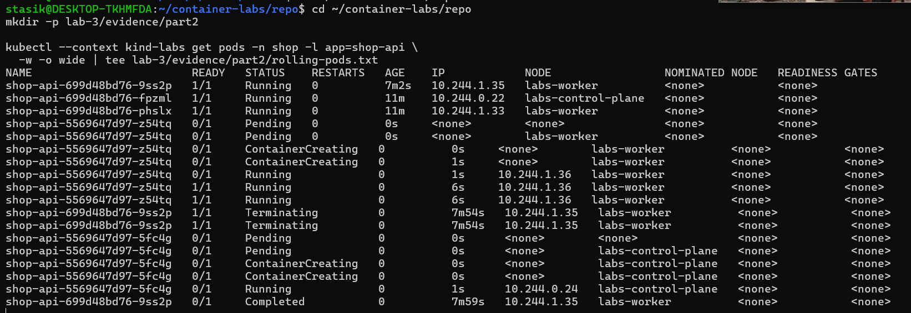
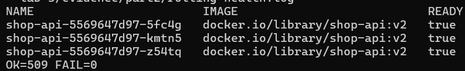

Результат нагрузки: **OK=509, FAIL=0**. Это результат измеренного интервала, а не гарантия отсутствия ошибок при любой нагрузке.

#### Сломанное обновление и rollback

Выставил `api.healthFail=true` и выполнил `helm upgrade`. Новый Pod не прошёл readiness, `/health` отвечал 503. Поскольку liveness также использует `/health`, контейнер перезапускался. Три старых исправных Pod продолжили работу, а обновление завершилось ошибкой `Progress deadline exceeded`.

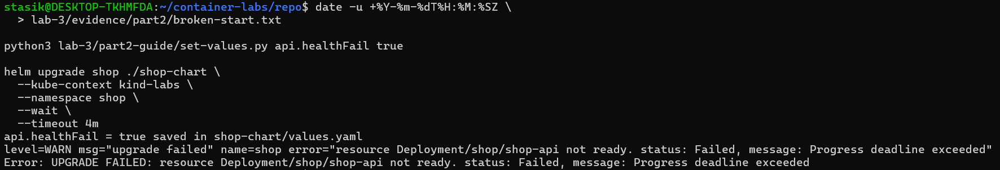
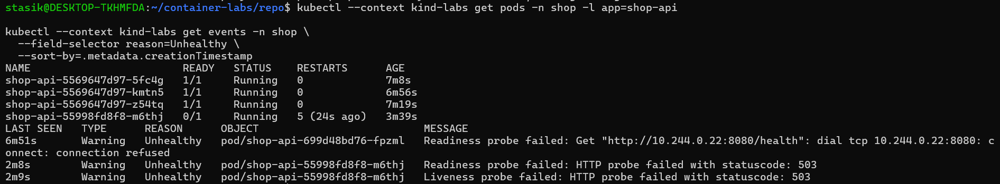

Выполнил rollback на исправную ревизию 4:

```bash
helm rollback shop 4 --kube-context kind-labs \
  --namespace shop --wait --timeout 5m
```

Helm создал ревизию 6 с описанием `Rollback to 4`; ревизия 5 осталась в истории как failed. В values вернул `api.healthFail=false`, чтобы следующее обновление не повторило неисправную конфигурацию.

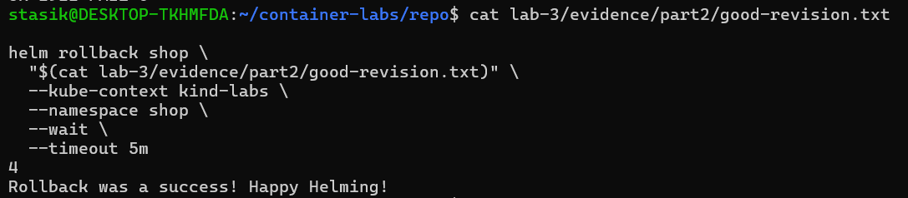
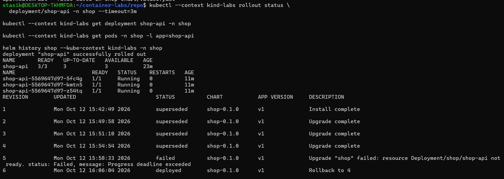
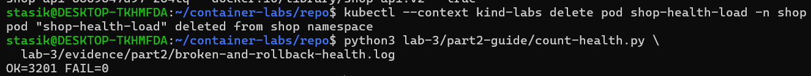

За интервал сломанного обновления и восстановления: **OK=3201, FAIL=0**. Поле `APP VERSION` в истории Helm — метаданные Chart.yaml; фактически работающий образ после rollback — `shop-api:v2`.

### Часть 3. PostgreSQL через оператор

Установил CloudNativePG один раз в namespace `cnpg-system`. В чарт приложения добавил [postgres.yaml](../shop-chart/templates/postgres.yaml), создающий `Cluster` API `postgresql.cnpg.io/v1`. Настроил один экземпляр PostgreSQL и PVC 2 GiB со StorageClass `standard`.

Перед установкой проверил local-path provisioner: создание PVC, запись и чтение `storage-ok`, затем удаление Pod/PVC/PV. При первой попытке Kyverno заблокировал helper Pod; после точечного исключения для read-only rootfs создание и удаление томов заработало.

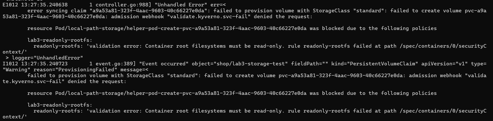
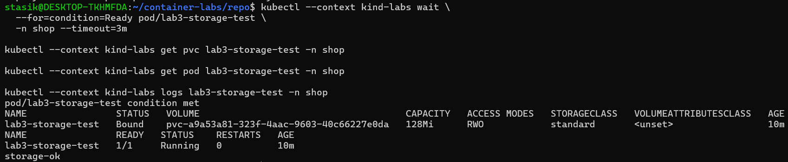
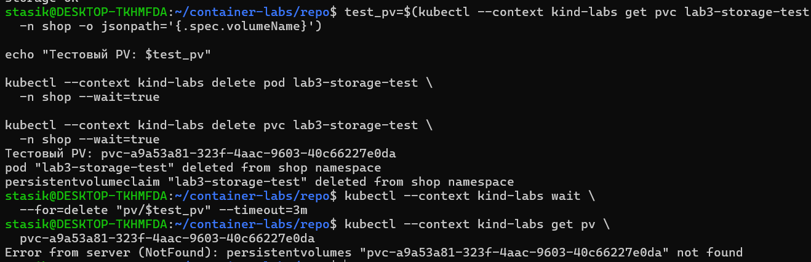
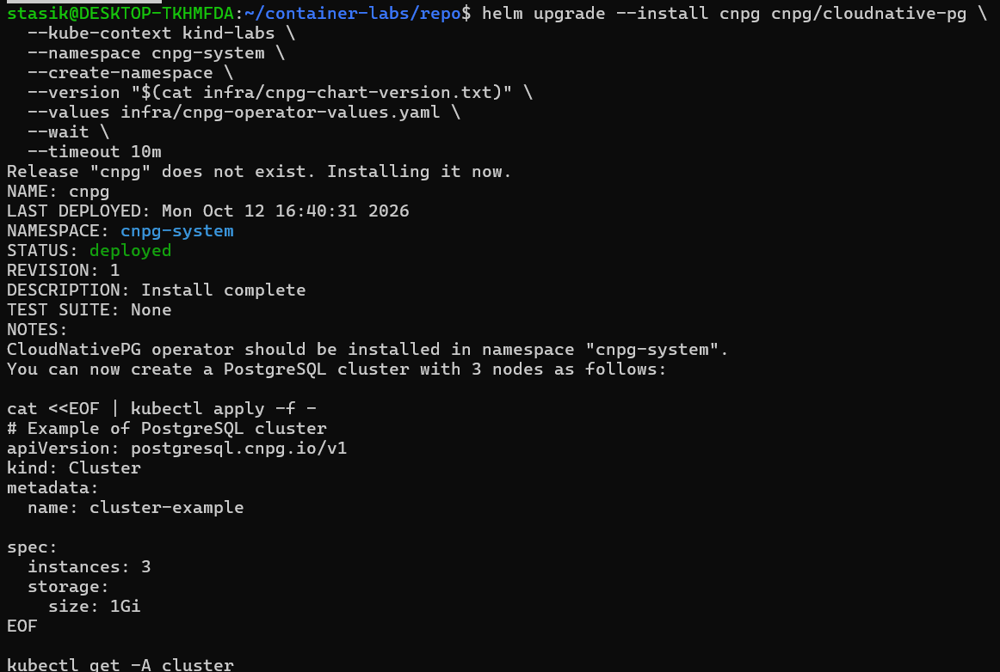

Остановил API и worker на время переноса, сохранил дамп временной БД и восстановил его в новой. После переключения на Secret `shop-postgres-app` старый заказ сохранился, новый `cnpg-test` прошёл из pending в processed.

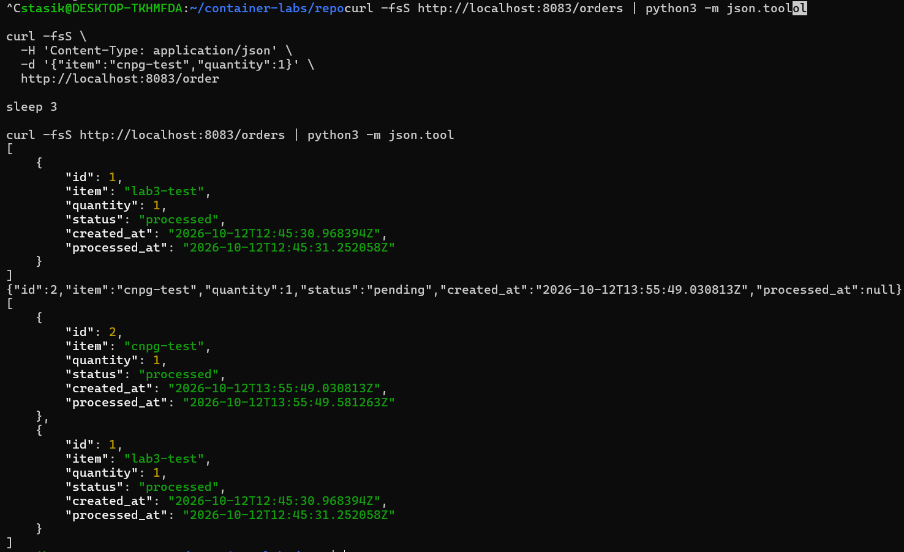

Удалил PostgreSQL Pod:

```bash
kubectl --context kind-labs delete pod shop-postgres-1 -n shop
```

Оператор создал Pod с прежним именем и новым UID. После появления новый Pod достиг Ready примерно за 11 секунд; это не полное время недоступности, так как остановка старого экземпляра заняла дополнительное время. PVC и связанный PV остались прежними, оба заказа сохранились.

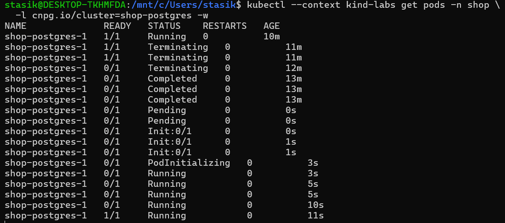
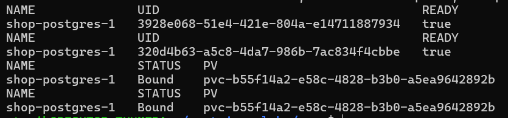
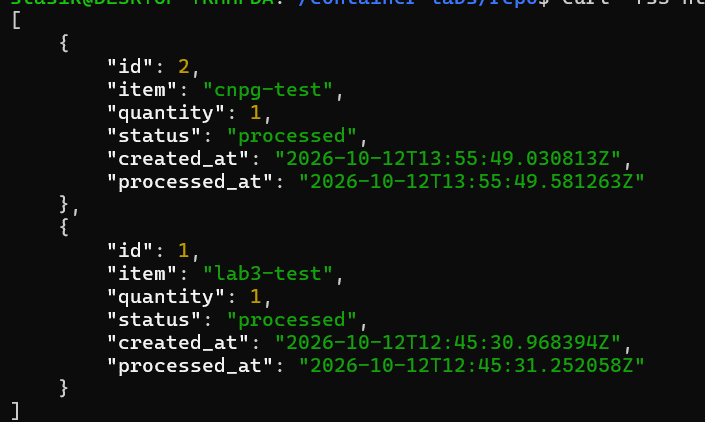

#### Spec, status и роль оператора

В объекте Cluster `spec` задаёт желаемое состояние: `instances: 1`, размер хранилища `2Gi`, StorageClass `standard`. В `status` после восстановления получено:

```text
phase: Cluster in healthy state
instances: 1
readyInstances: 1
currentPrimary: shop-postgres-1
```

CRD расширяет API Kubernetes типом `Cluster`, а объект этого типа описывает конкретную базу. Само наличие CRD не запускает PostgreSQL: reconciliation выполняет контроллер CloudNativePG.

`kube-controller-manager` содержит встроенные контроллеры Kubernetes, например Deployment и ReplicaSet. Они поддерживают общие механизмы: количество реплик, создание и удаление Pod. Оператор CloudNativePG использует тот же принцип сравнения желаемого и фактического состояния, но понимает PostgreSQL: инициализацию базы, primary/replica, сертификаты и восстановление экземпляра. Встроенные контроллеры не интерпретируют спецификацию PostgreSQL Cluster.

Один экземпляр с PVC обеспечивает сохранение данных при замене Pod, но не высокую доступность БД. Local-path том привязан к узлу; потеря узла или его диска не эквивалентна удалению Pod и этим экспериментом не проверялась.

### Часть 4. Недоступность API-сервера

Для проверки использовал `docker exec labs-worker curl` и ClusterIP сервисов. Такой запрос не проходит через `kubectl port-forward` и не требует API-сервера для каждой операции.

API-сервер — static Pod. В эксперименте его манифест временно переносился из `/etc/kubernetes/manifests/` в `/etc/kubernetes/lab4-disabled/`. Восстановление выполнялось возвращением файла. Сам Docker-контейнер узла, kubelet и etcd не останавливались.

Проверки доступности приложения:

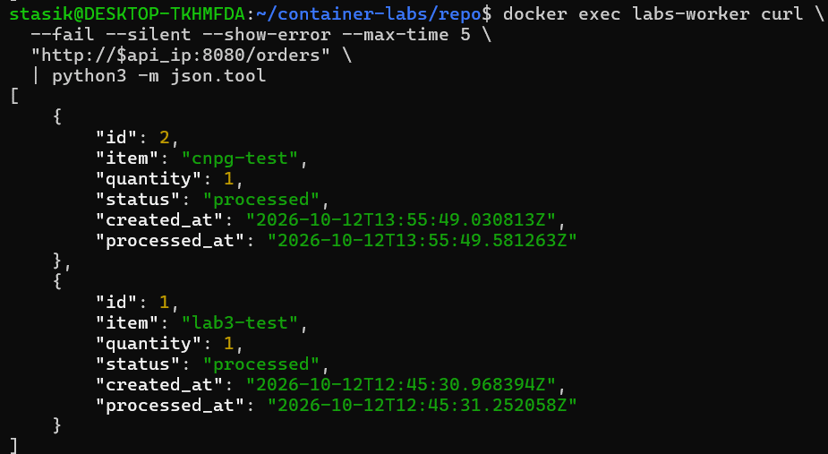
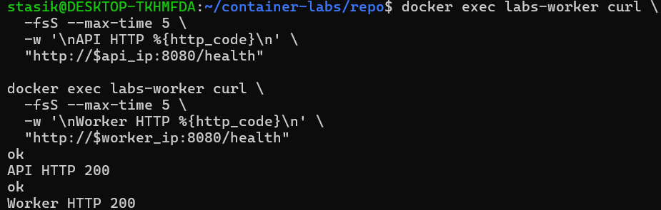

После возврата API-сервера оба узла были Ready, создание тестового ConfigMap прошло успешно. API имел 3/3 реплики, worker — 2/2, PostgreSQL находился в healthy state. Тестовый ConfigMap удалён.

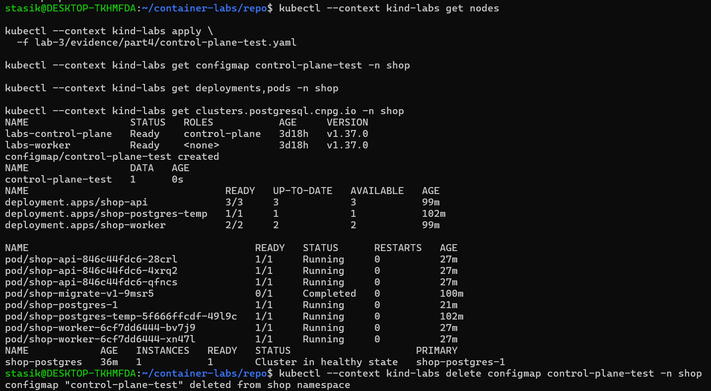

Работающие контейнеры и существующие сетевые правила могут продолжать обслуживать трафик при недоступности API-сервера. Однако изменения Kubernetes-ресурсов и reconciliation, которому нужен API, недоступны. Это не означает, что кластер способен неограниченно работать без control plane или корректно переживёт одновременно замену Pod/узла.

**Ограничение приложенных доказательств:** в подборке есть HTTP 200, чтение заказов и успешное управление после восстановления, но нет отдельного скрина отказа `kubectl apply` во время отключения. Для полного отчёта этот скрин нужно добавить. Обработка нового заказа `control-plane-down` на имеющихся изображениях также не показана; она не подменяется результатами старых заказов.

### Часть 5. Мониторинг

Использован существующий `kube-prometheus-stack` из лабораторной 2. В чарт добавлены [ServiceMonitor](../shop-chart/templates/servicemonitor.yaml) и [PrometheusRule](../shop-chart/templates/prometheusrule.yaml). ServiceMonitor выбирает Service API и worker по меткам и опрашивает `/metrics` на именованном порту `http` каждые 15 секунд.

В Grafana запрос `up{namespace="shop",service=~"shop-api|shop-worker"}` вернул пять целей со значением 1: три API и два worker.

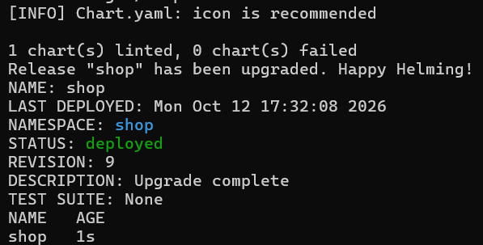
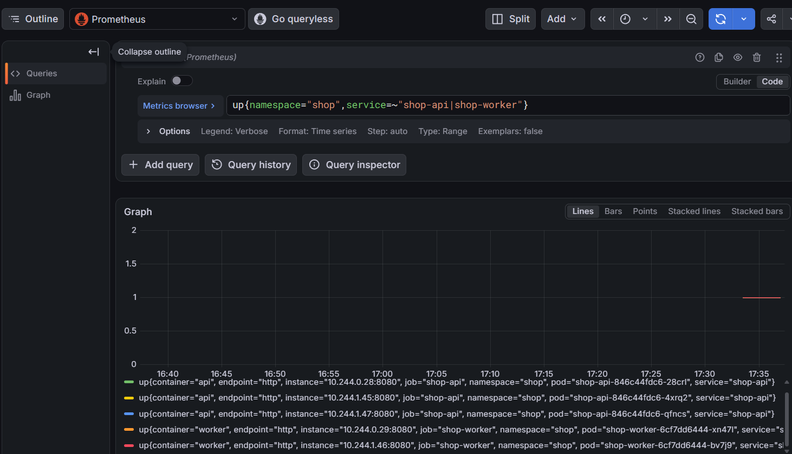

| Алерт | Условие | Почему нужен |
| --- | --- | --- |
| `ShopTargetDown` | `up == 0` для API/worker в течение 1 минуты | Обнаруживает ошибки сбора метрик отдельного экземпляра; не заменяет функциональную проверку и не обнаруживает все случаи исчезновения целей |
| `ShopApiHighErrorRatio` | Доля HTTP 5xx выше 5% по окну 2 минуты при общем трафике более 0.1 запроса/с, `for: 1m` | Выявляет устойчивые ошибки запросов; ограничение по трафику уменьшает влияние единичных запросов |
| `ShopWorkerErrors` | Суммарный рост `worker_errors_total` за 5 минут больше нуля, `for: 1m` | Обнаруживает ошибки опроса БД и транзакций worker даже при доступном HTTP-сервере |

Пороги выбраны для учебного стенда. Проверка Prometheus API показала три загруженных правила, `health=ok`, без ошибок вычисления.

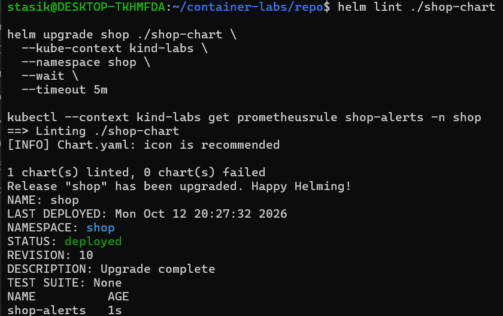

Чтобы вызвать алерт, отправлял запросы к `/fail`, возвращающему HTTP 500. Условие высокой доли ошибок перешло в pending, затем в firing. После окончания нагрузки алерт вернулся в inactive.

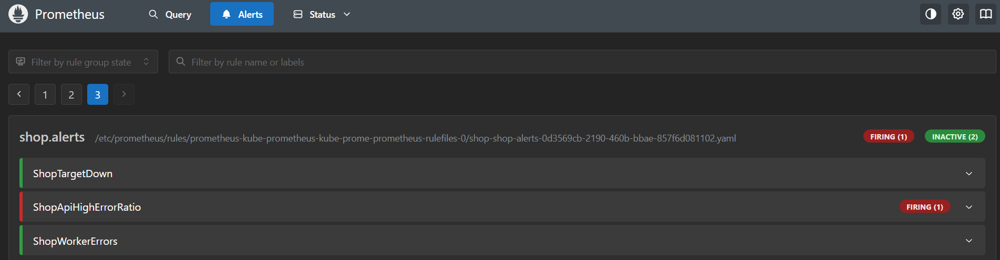
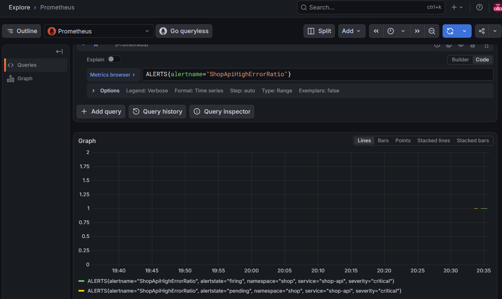
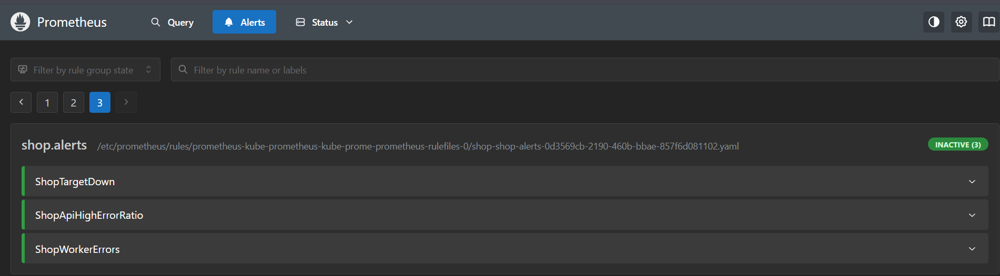

Ранее настроенный RED-дашборд старого `api-service` приведён ниже как подтверждение подготовки стека. Он не является отдельным дашбордом `shop`: для полного соответствия итоговому требованию нужен дашборд с запросами по сервисам `shop-api` и `shop-worker`.

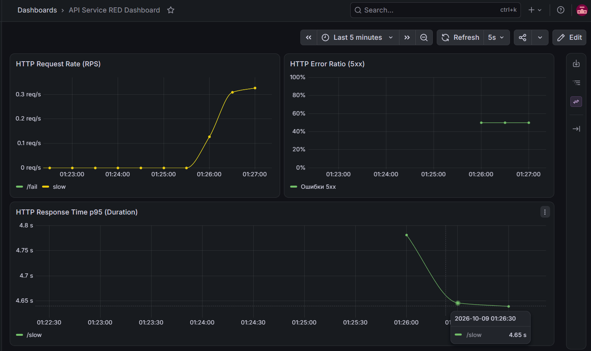

### Результат и границы проверки

Пять политик проверены отрицательными примерами; допустимые PodSpec приняты. Подтверждены reconciliation API, изменение replicas через Helm, rolling update и rollback без ошибок в измеренных запросах. PostgreSQL управляется CloudNativePG; после удаления Pod данные сохранились. Подтверждены восстановление управления кластером и срабатывание пользовательского алерта.

При этом первоначальная установка API/worker выполнялась с временной БД и отдельным Job миграции, а новая БД получила схему через дамп. Установка **итогового** чарта в пустое namespace без ручной подготовки таблиц отдельно не проверена. Перед окончательной сдачей нужно включить инициализацию схемы в воспроизводимый процесс установки и проверить его, добавить дашборд shop и недостающее доказательство отказа изменения при отключённом API-сервере.

### Материалы

- [Задание лабораторной 3](https://github.com/KeladKaal/containerization-and-orchestration/blob/main-rus/lecture-3-kubernetes-control-plane/lab.md).
- [Предыдущая лабораторная работа](../lab-2/README.md).
- [Каталог всех скриншотов](SCREENSHOTS.md).
