# Лабораторная работа 4 — SLA критического пути под перегрузкой

В работе проверяется, как сохранить оформление заказа `api → postgres` при дефиците ресурсов в двухнодовом kind-кластере. Второстепенная нагрузка `batch` получает низкий приоритет и может быть вытеснена. Основные эксперименты выполнены через Helm-чарт `shop` с отдельными файлами значений.

В итоговых тестах API вытеснил два batch-пода при нехватке CPU requests, а kubelet дважды вытеснил batch при достижении временного порога памяти. В обоих 15-минутных прогонах k6 выполнено по 4501 запросу без HTTP-ошибок и пропущенных итераций. HTTP p95 составил **5,24 мс** при preemption и **6,18 мс** при memory eviction. Все заказы затем обработаны worker.

**Ограничение части 3:** сохранённый отчёт KRR содержит рекомендации для API, worker и batch, но не для PostgreSQL под управлением CloudNativePG. Ресурсы PostgreSQL подобраны по Prometheus и проверены повторной нагрузкой. Также CPU API оставлен выше рекомендации KRR. Поэтому буквальное требование получить и применить все числа критического пути из KRR выполнено не полностью; ниже приведены реальные рекомендации и фактически применённые значения.

## Стенд и файлы

| Компонент | Конфигурация |
| --- | --- |
| Кластер | kind `labs`, контекст `kind-labs`, Kubernetes v1.37.0 |
| Ноды | `labs-control-plane`, `labs-worker`, обе Ready |
| Namespace / Helm release | `shop` / `shop` |
| API | 3 реплики, `shop-api:v2` |
| Worker | 6 реплик в лабораторной 4, `shop-worker:v1` |
| PostgreSQL | CloudNativePG, кластер `shop-postgres`, 1 экземпляр |
| Batch | `shop-batch:v1`, 1 реплика в обычном режиме |
| Мониторинг | Prometheus и Grafana из существующего `kube-prometheus` |

Ноды kind работают на одном хосте WSL. Их отображаемую память нельзя складывать как память двух физических серверов. Metrics API для `kubectl top` отсутствовал, поэтому измерения получены из Prometheus и kubelet stats summary.

Базовый [values.yaml](../shop-chart/values.yaml) сохраняет настройки лабораторной 3: batch выключен, worker имеет две реплики, настройки приоритетов и нового дашборда не включены. [lab-4/values.yaml](values.yaml) накладывает настройки лабораторной 4. Экспериментальные изменения вынесены в [experiments](experiments).

Основные материалы:

- [Код batch](../shop-services/batch/main.go) и [Dockerfile](../shop-services/batch/Dockerfile).
- [Helm-шаблоны](../shop-chart/templates) и [дашборд лабораторной 4](../shop-chart/dashboards/shop-lab4.json).
- [Сценарий заказов k6](load/orders.js) и [провокация ошибок](load/alert-errors.js).
- [Текстовые доказательства](evidence) и [каталог всех 42 скриншотов](screenshots/README.md).
- Образы инструментов закреплены digest в [k6-image.txt](k6-image.txt) и [krr-image.txt](krr-image.txt).

## Часть 0 — Сервис batch

Go-программа выделяет `MEMORY_MIB` MiB, касается страниц памяти и периодически обновляет их. `CPU_WORKERS` задаёт число вычислительных циклов. При `CPU_WORKERS=0` вычислительная нагрузка отключается, но выделение и поддержание памяти продолжаются. SIGTERM/SIGINT обрабатываются для завершения процесса.

Образ собирается в два этапа: `golang:1.26-alpine` для сборки, `scratch` для исполнения, UID/GID 65532. Сборка из корня репозитория:

```bash
docker build -f shop-services/batch/Dockerfile \
  -t docker.io/library/shop-batch:v1 shop-services
kind load docker-image docker.io/library/shop-batch:v1 --name labs
```

## Часть 1 — Выбор механизма разнесения

В [api-deployment.yaml](../shop-chart/templates/api-deployment.yaml) добавлен параметр `api.placement`:

| Значение | Поведение |
| --- | --- |
| `none` | Дополнительные ограничения не добавляются; режим базового чарта |
| `podAntiAffinity` | Мягкое предпочтение разных нод, `preferredDuringSchedulingIgnoredDuringExecution`, вес 100 |
| `topologySpreadConstraints` | `maxSkew: 1`, ключ `kubernetes.io/hostname`, `DoNotSchedule` |

Выбран `topologySpreadConstraints`: три реплики можно распределить по двум нодам как 1+2, ограничив дисбаланс. Жёсткая anti-affinity «один API на ноду» на двух нодах оставила бы третью реплику Pending. Реализованная мягкая anti-affinity допускает размещение, но не обеспечивает такую же строгость распределения.

Селектор содержит имя приложения, компонент и instance релиза. `matchLabelKeys: [pod-template-hash]` разделяет ревизии при подсчёте распределения во время rolling update.

## Часть 2 — Тесная площадка и развёртывание

Используются ровно две ноды. Batch включается условным [шаблоном Deployment](../shop-chart/templates/batch-deployment.yaml). В обычном режиме ему заданы requests `50m / 96Mi`, limits `250m / 128Mi`, нагрузка `CPU_WORKERS=1`, `MEMORY_MIB=64`.

У batch сохранены требования безопасности: non-root, `RuntimeDefault` seccomp, read-only root filesystem, запрет повышения привилегий и privileged, сброс capabilities, отключён automount токена ServiceAccount. Лимиты CPU и памяти присутствуют во всех экспериментальных профилях.

Развёртывание на подготовленном стенде из лабораторной 3:

```bash
helm lint ./shop-chart
helm lint ./shop-chart -f lab-4/values.yaml
helm upgrade shop ./shop-chart --kube-context kind-labs \
  --namespace shop --reset-values -f lab-4/values.yaml \
  --wait --timeout 10m
```

`--reset-values` предотвращает наследование значений предыдущего эксперимента. До начала работы временная БД была выгружена в резервную копию вне Git, затем временный Deployment PostgreSQL и тестовый релиз `shop-clean` удалены. Рабочие API и worker использовали Secret `shop-postgres-app`, ключ `uri`, от CloudNativePG.

## Часть 3 — Нагрузка, KRR и подбор ресурсов

### Исходная нагрузка

Сценарий k6 отправляет `POST /order` с уникальным для прогона `RUN_ID` в поле `item`: 5 итераций/с в течение 15 минут, 10 заранее выделенных VU, до 30 VU. Проверяется HTTP 200/201 и положительный `id`. По этому же `item` затем выбираются заказы в PostgreSQL.

При двух worker HTTP оставался быстрым, но обработка заказов не успевала за поступлением. После завершения очереди SQL показал p95 **1 283 274,61 мс**, то есть около 21,4 минуты. Увеличение worker до шести снизило его до **808,09 мс**.

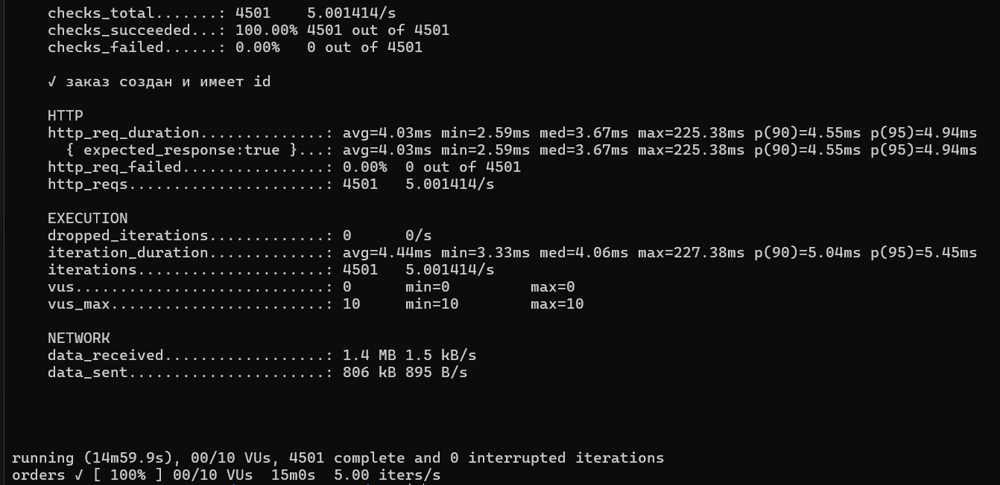

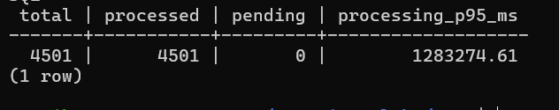

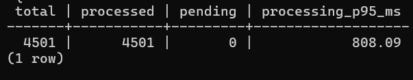

### Рекомендации KRR и фактические настройки

Полный исходный вывод: [krr-before.txt](evidence/krr-before.txt). Стратегия Simple: CPU request по 95-му процентилю, CPU limit — `unset`; память — максимум с запасом 15%. История — 1 час, шаг — 0,5 минуты. KRR сообщил о недостаточной истории, но рассчитал рекомендации. Для завершённого Job миграции данных не было.

| Сервис | Исходные CPU request / limit | KRR CPU request / limit | Исходная память request / limit | KRR память request / limit | Финальные значения лабораторной 4 |
| --- | --- | --- | --- | --- | --- |
| API | 100m / 500m | 10m / unset | 64Mi / 128Mi | 100Mi / 100Mi | CPU 100m / 100m; память 100Mi / 100Mi |
| Worker | 50m / 250m | 10m / unset | 64Mi / 128Mi | 100Mi / 100Mi | CPU 10m / 250m; память 100Mi / 100Mi; 6 реплик |
| Batch | 50m / 250m | 251m / unset | 96Mi / 128Mi | 100Mi / 100Mi | CPU 50m / 250m; память 96Mi / 128Mi |
| PostgreSQL | 100m / 1 CPU | Нет в отчёте | 256Mi / 512Mi | Нет в отчёте | CPU 1 / 1; память 256Mi / 256Mi |

Рекомендация убрать CPU limits не применялась: лимиты требуются гвардрейлами. Для API приняты рекомендации по памяти, но CPU сохранён с запасом и выровнен request/limit для Guaranteed. У worker принят CPU request 10m и память 100Mi. Batch оставлен намеренно ограниченным Burstable; его профиль не является буквальным применением рекомендаций KRR.

Отдельного скриншота KRR среди предоставленных изображений нет; исходная таблица доступна по ссылке выше. Неудачный запуск более раннего образа сохранён в [krr-old-error.txt](evidence/krr-old-error.txt) и не используется как результат анализа.

### PostgreSQL и проверка ошибочной настройки

Для периода `2026-10-13T13:42:32Z–13:57:35Z` Prometheus дал 31 точку: CPU p95 **50,74m**, максимум **55,74m**; memory working set p95 **125,70 MiB**, максимум **126,28 MiB**. См. [postgres-load-resources.txt](evidence/postgres-load-resources.txt).

Попытка установить PostgreSQL `requests=limits=100m` CPU и `256Mi` памяти привела к деградации: **8,09% HTTP-ошибок**, HTTP p95 **5 с**, 41 пропущенная итерация. Доля CPU-периодов с throttling у PostgreSQL достигала p95 **85,28%**, максимум **99,79%**. Усреднённый CPU оказался недостаточным основанием для жёсткого лимита при кратковременных пиках.

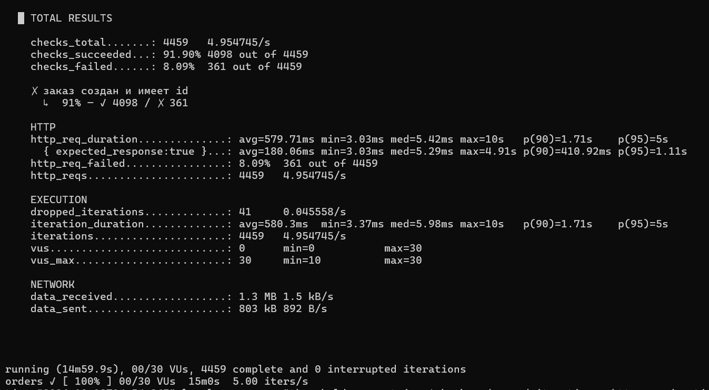

CPU PostgreSQL увеличен до `requests=limits=1`, память оставлена 256Mi. Повторный прогон: 4500 запросов, ошибок и пропусков нет, HTTP p95 **4,74 мс**, SQL p95 **144,17 мс**. Это проверенная конфигурация, а не доказанный минимальный размер CPU.

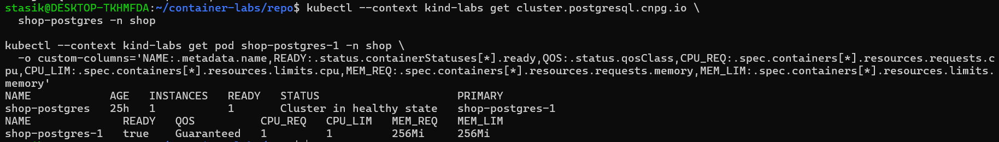

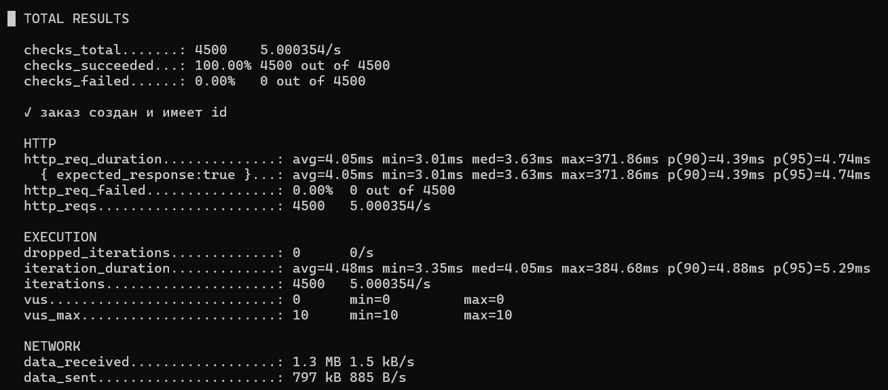

Доказательства: [throttling](evidence/cpu-throttling-resources.txt), [неудачный k6](evidence/k6-resources.txt), [успешный k6](evidence/k6-pgcpu1.txt), [SQL](evidence/orders-pgcpu1.txt).

## Часть 4 — Реплики API на разных нодах

После применения topology spread одна реплика API размещена на `labs-control-plane`, две — на `labs-worker`; все Running и Ready. Доказательства: [вывод pods](evidence/api-placement.txt), [настройки spread](evidence/api-spread-settings.json).

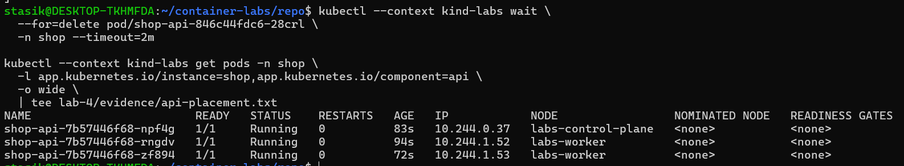

Такое размещение снижает риск одновременной потери всех API-подов при проблеме одной ноды. Оно не делает весь стенд высокодоступным: PostgreSQL имеет один экземпляр, обе ноды kind находятся на одном физическом хосте.

## Часть 5 — Приоритеты, QoS и PDB

| Компонент | QoS | PriorityClass / значение | PDB |
| --- | --- | --- | --- |
| API | Guaranteed | `shop-shop-critical`, 10000 | `shop-api`, minAvailable 2 |
| PostgreSQL | Guaranteed | `shop-shop-critical`, 10000 | Управляемый CNPG `shop-postgres-primary`, minAvailable 1 |
| Worker | Burstable | Не задан, 0 | Не добавлялся |
| Batch | Burstable | `shop-shop-batch`, −1000 | Не добавлялся |

PriorityClass создаются [шаблоном чарта](../shop-chart/templates/priorityclasses.yaml). У critical — `PreemptLowerPriority`, у batch — `Never`: batch не может инициировать preemption, но сам может быть его жертвой. [PDB API](../shop-chart/templates/api-pdb.yaml) включается через values. PostgreSQL PDB создаёт оператор; отдельного дублирующего шаблона PDB PostgreSQL в chart нет.

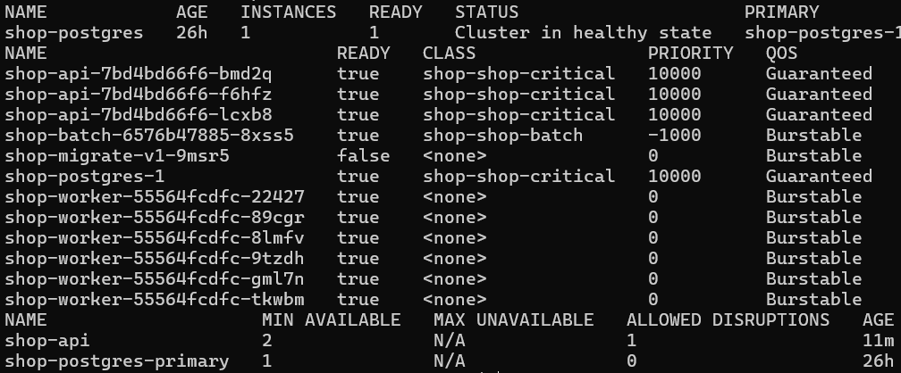

Guaranteed требует одинаковых ненулевых requests и limits CPU/памяти для всех контейнеров пода. Это не обещание отсутствия задержек или OOM. При preemption планировщик учитывает приоритет, а не простую очередность QoS-классов. При node-pressure eviction важны превышение requests, приоритет и величина превышения: низкоприоритетный batch с памятью существенно выше request оказался первым кандидатом. PDB ограничивает добровольные eviction через API; не защищает от OOM и node-pressure eviction, а при preemption учитывается по возможности. См. [приоритеты](https://kubernetes.io/docs/concepts/scheduling-eviction/pod-priority-preemption/) и [node-pressure eviction](https://kubernetes.io/docs/concepts/scheduling-eviction/node-pressure-eviction/).

Изменение priorityClassName в CR PostgreSQL сначала не изменило существующий под. После его пересоздания проверены priority 10000, Guaranteed и здоровый кластер. Снимки 12–13 в каталоге фиксируют промежуточное состояние; итоговое доказательство — снимок 14.

## Часть 6 — Pending и preemption со стороны API

Через [batch-pending.yaml](experiments/batch-pending.yaml) заданы 7 реплик batch, CPU request/limit по 3, память request 32Mi / limit 64Mi, `CPU_WORKERS=0`, `MEMORY_MIB=16`. Batch остаётся Burstable из-за разных requests/limits памяти. Шесть реплик запустились, одна осталась Pending с `Insufficient cpu`.

Причина — резервирование по requests, а не загрузка CPU: при отключённых вычислительных циклах каждый batch всё равно требует 3 CPU для планирования. На control-plane было зарезервировано 11690m из 12000m, на worker — 10565m. Свободных 310m и 1435m недостаточно для ещё одного batch.

Доказательства: [причина Pending](evidence/batch-pending-reason.txt), [распределение перед итоговым опытом](evidence/api-preemption/batch-before.txt), [резервации нод](evidence/api-preemption/node-reservations.txt).

Для итогового опыта файл [api-preemption.yaml](experiments/api-preemption.yaml) временно повышает CPU request/limit API до 2, оставляя память 100Mi. Новая реплика API не помещается без освобождения ресурсов. На фоне k6 выполнен Helm upgrade с базовым профилем лабораторной 4 и обоими экспериментальными файлами; `--wait` для всего релиза не использовался, поскольку Pending batch ожидается. Отдельно проверен rollout API.

Два события `Preempted` сопоставлены по UID с новыми API-подами:

| Вытесненный batch | API-инициатор | Нода |
| --- | --- | --- |
| `shop-batch-7d45758578-dzvj7` | `shop-api-8764999c8-9xxvw` | labs-control-plane |
| `shop-batch-7d45758578-j4j6g` | `shop-api-8764999c8-7jttq` | labs-worker |

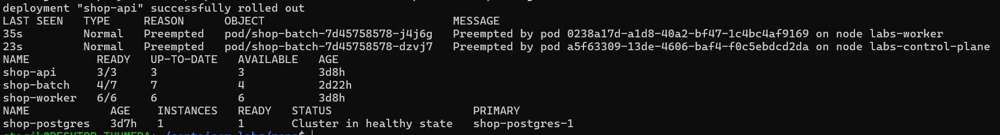

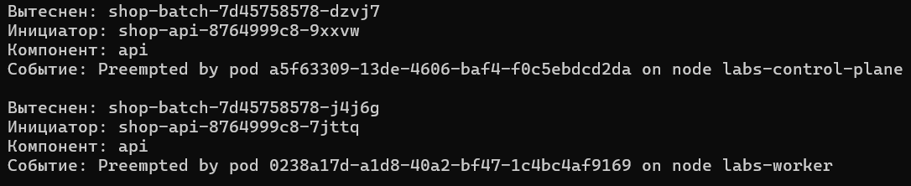

API завершил rollout с 3/3, worker сохранил 6/6, PostgreSQL — healthy. Batch деградировал с 6/7 до 4/7, Pending вырос с 1 до 3. [События](evidence/api-preemption/preempted-events.json), [UID](evidence/api-preemption/uid-match.txt), [rollout](evidence/api-preemption/api-rollout.txt).

Ранние опыты с отдельным `shop-preemption-probe` сохранены как предварительная проверка. Они не заменяют итоговое доказательство вытеснения самим API.

## Часть 7 — Memory eviction и отличие от OOMKilled

### OOM по собственному лимиту

В отдельном [batch-oom.yaml](experiments/batch-oom.yaml) задано выделение 256Mi при memory limit 128Mi. Контейнер завершился с `OOMKilled`, exit code 137. Это превышение лимита контейнера, а не решение планировщика и не доказательство нехватки памяти всей ноды.

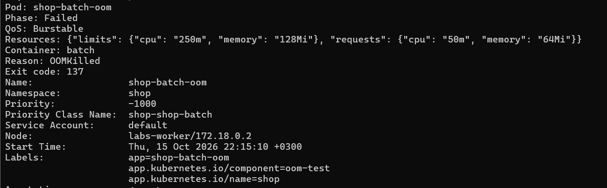

[Описание пода](evidence/batch-oom-describe.txt) и [результат](evidence/batch-oom-result.txt).

### Eviction batch, развёрнутого Helm

Основной опыт использует [batch-memory-eviction.yaml](experiments/batch-memory-eviction.yaml): 1 реплика на `labs-worker`, `CPU_WORKERS=0`, `MEMORY_MIB=512`; requests `50m / 32Mi`, limits `250m / 768Mi`. Временная стратегия `Recreate` исключает две одновременно работающие реплики при обновлении. При переходе с RollingUpdate потребовалось удалить прежнее поле `rollingUpdate` через merge patch; параметры нагрузки и размещения применены Helm.

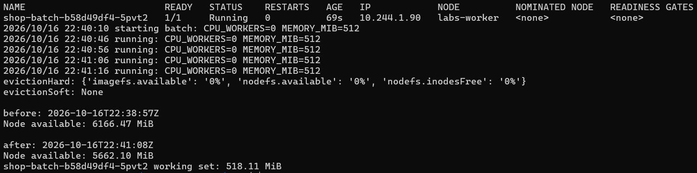

После увеличения нагрузки memory working set batch составил **518,11 MiB**. Доступная память ноды уменьшилась с **6166,47 до 5662,10 MiB**. Лимит 768Mi не превышен.

В исходной конфигурации kind не было memory eviction threshold: hard-пороги относились только к диску и были равны 0%, soft-пороги отсутствовали. Для контролируемой проверки временно включены `evictionSoft.memory.available=5900Mi`, grace period 30s, `evictionMaxPodGracePeriod=5`, transition period 30s. Порог выбран между доступной памятью до и после batch. Поэтому это давление относительно специально установленного порога, а не исчерпание всей памяти WSL.

Настройки kubelet сохранены заранее. Внутри kind-ноды поставлен systemd-таймер восстановления через 180 секунд; основной блок также восстанавливал конфигурацию при выходе. Файл [worker-helm-eviction.json](experiments/worker-helm-eviction.json) привязан к этому стенду: его не следует применять к другой ноде без пересчёта и проверки.

Kubelet поставил batch первым в списке кандидатов и зарегистрировал два успешных eviction:

- `2026-10-16 22:44:20 UTC`: `shop-batch-b58d49df4-5pvt2`;
- `2026-10-16 22:45:44 UTC`: его замена `shop-batch-b58d49df4-z8dhg`.

Причина событий — недостаточная память относительно порога 5900Mi; request batch 32Mi, использование около 518Mi. Deployment создавал замену, которая временно не планировалась из-за taint ноды и привязки к worker. После восстановления порогов новая реплика запустилась. API оставался 3/3, worker — 6/6, PostgreSQL — healthy.

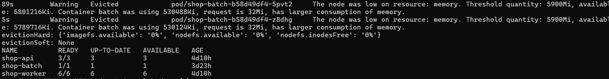

Доказательства: [события Evicted](evidence/helm-eviction/evicted-summary.txt), [журнал с порядком кандидатов](evidence/helm-eviction/kubelet-log.txt), [исходная память](evidence/helm-eviction/memory-before.json), [память после нагрузки](evidence/helm-eviction/memory-after.json), [восстановление evictionSoft](evidence/helm-eviction/config-restored.txt).

Статусы некоторых завершённых подов позднее отображались как Completed/ContainerStatusUnknown, поэтому диагноз основан на событиях `Evicted` и журнале kubelet. Это отличается от контрольного OOM-теста с `OOMKilled` и кодом 137. Повторный опыт с Helm заменяет предварительный опыт с отдельным `shop-batch-eviction`.

## Часть 8 — SLA одновременно с перегрузкой

Принятый критерий для каждого 15-минутного прогона при 5 заказах/с: **HTTP p95 < 300 мс**, доля HTTP-ошибок **< 1%**, успешных проверок **> 99%**, пропущенных итераций **0**. HTTP измеряет ответ создания заказа в API с записью в БД. Время асинхронной обработки worker — отдельная метрика SQL `processed_at - created_at`; оно не подменяет HTTP latency.

| Прогон | Запросы k6 | HTTP errors | HTTP p95 | Dropped | SQL p95 обработки |
| --- | ---: | ---: | ---: | ---: | ---: |
| Исходные 2 worker | 4501 | 0% | 4,94 мс | 0 | 1 283 274,61 мс |
| 6 worker, до изменения ресурсов | 4501 | 0% | 5,87 мс | 0 | 808,09 мс |
| PG CPU limit 100m | 4459 | 8,09% | 5 с | 41 | 9887,80 мс |
| PG CPU request/limit 1 | 4500 | 0% | 4,74 мс | 0 | 144,17 мс |
| Предварительный опыт с probe | 4501 | 0% | 5,41 мс | 0 | 200,42 мс |
| **Preemption самим API** | **4501** | **0%** | **5,24 мс** | **0** | **159,05 мс** |
| **Memory eviction через Helm** | **4501** | **0%** | **6,18 мс** | **0** | **171,13 мс** |

В неудачном прогоне с PG 100m SQL содержит 4183 заказа: количество записей в БД не обязано совпадать с успешными клиентскими проверками при таймаутах. В двух итоговых опытах SQL подтверждает по 4501 обработанному заказу, pending 0.

### Preemption API под нагрузкой

Период UTC: **15.10.2026 21:28:52–21:43:54**. Время Москвы: **16.10.2026 00:28:52–00:43:54**. Обновление API началось примерно через минуту после запуска нагрузки. Итоговый код k6 — 0.

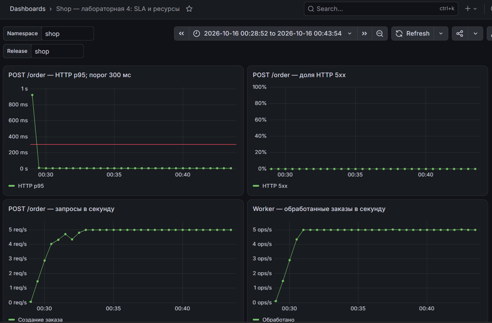

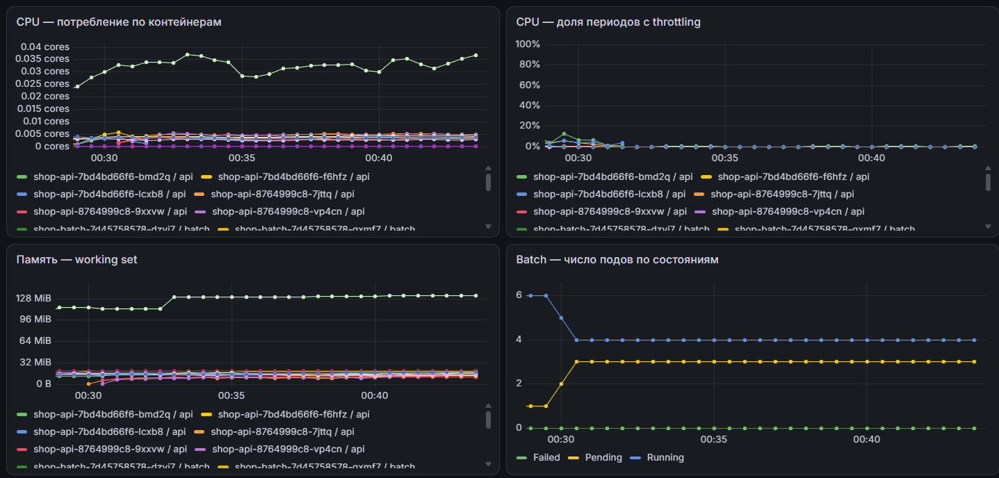

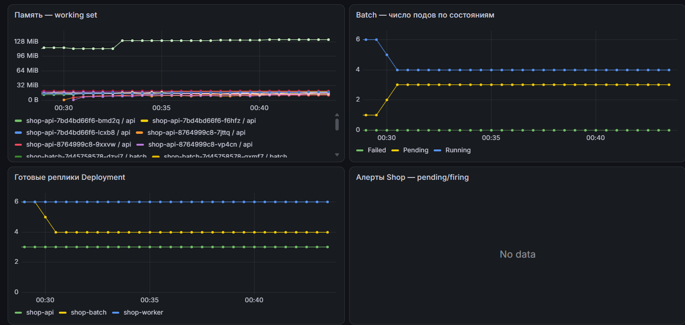

На начальном участке графика оконный p95 поднимается примерно до 900 мс. Утверждение «каждое скользящее окно ниже 300 мс» этим тестом не подтверждается. Принятый критерий относится к p95 всего прогона k6; максимум отдельного запроса составил 963,7 мс. Prometheus считает приближённый квантиль по бакетам в окне `[2m]`, k6 — итоговую статистику своего прогона.

[k6](evidence/api-preemption/k6.txt), [код завершения](evidence/api-preemption/exit-code.txt), [SQL](evidence/api-preemption/orders.txt), [начало](evidence/api-preemption/start.txt), [конец](evidence/api-preemption/end.txt).

### Memory eviction под нагрузкой

Период UTC: **16.10.2026 22:42:44–22:57:49**. Время Москвы: **17.10.2026 01:42:44–01:57:49**. Оба eviction попадают внутрь прогона. Итоговый код k6 — 0; максимальная HTTP-задержка 1,03 с, итоговый p95 6,18 мс.

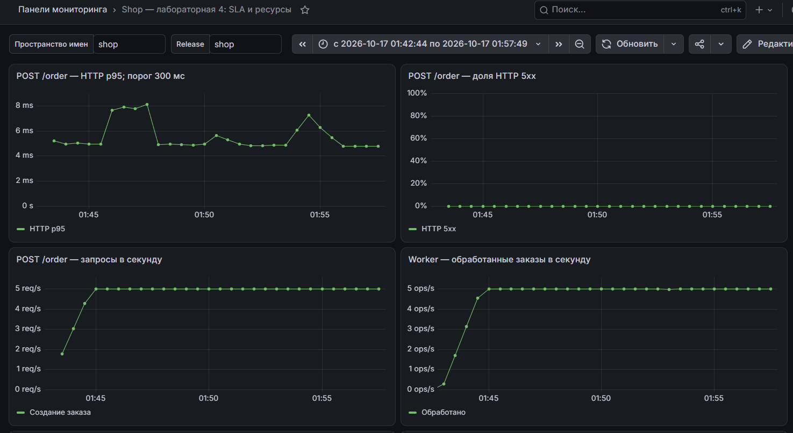

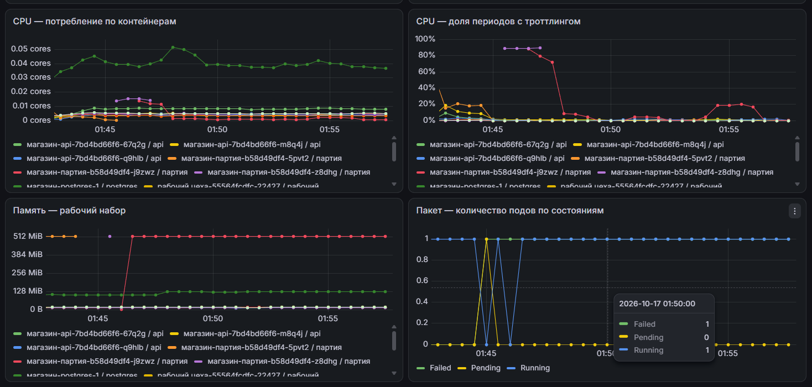

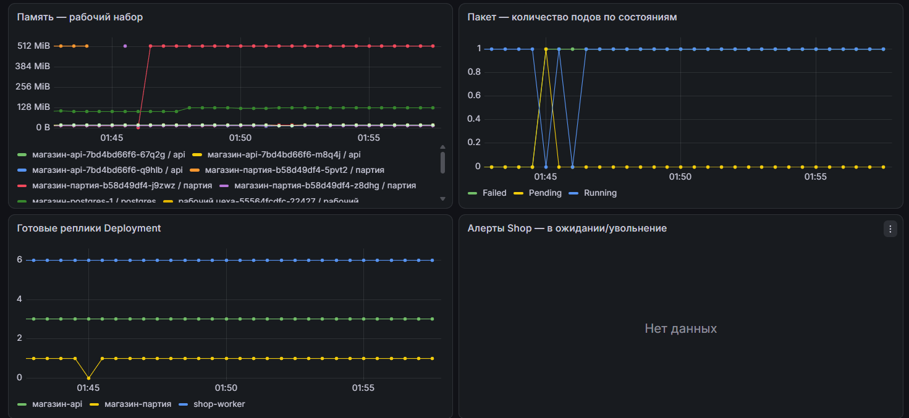

Графики показывают смену batch-подов с working set около 512Mi и временное падение готовности batch до нуля. Готовность API и worker сохраняется; HTTP 5xx остаётся нулевой, оконный p95 — примерно 5–8 мс, после выхода на нагрузку поток создания и обработки составляет около 5/с. Линия Failed учитывает завершённый под, а не дополнительную работающую реплику.

[k6](evidence/helm-eviction/k6.txt), [код завершения](evidence/helm-eviction/exit-code.txt), [SQL](evidence/helm-eviction/orders.txt), [начало](evidence/helm-eviction/start.txt), [конец](evidence/helm-eviction/end.txt).

Прерванный тест, двойной запуск и прогон с probe после окончания нагрузки сохранены в отдельных каталогах `sla-interrupted-*`, `sla-double-start`, `sla-before-preemption`. Они не используются как доказательство SLA одновременно с воздействием.

## Часть 9 — Мониторинг и алерты

[ServiceMonitor](../shop-chart/templates/servicemonitor.yaml) выбирает API и worker по меткам релиза, опрашивает `/metrics` на порту `http` каждые 15 секунд с timeout 10s. CPU/память поступают из метрик kubelet/cAdvisor, состояния подов и Deployment — из kube-state-metrics.

В [PrometheusRule](../shop-chart/templates/prometheusrule.yaml) используются три правила из общего чарта:

| Алерт | Условие | Для чего нужен |
| --- | --- | --- |
| `ShopTargetDown` | `up == 0` для цели API/worker дольше 1 минуты | Обнаружение недоступного endpoint метрик; не проверяет исчезновение всех целей |
| `ShopApiHighErrorRatio` | Доля HTTP 5xx > 5% по окну 2 минуты, поток > 0,1 запроса/с, `for: 1m` | Сигнал о деградации ответов API при реальном трафике |
| `ShopWorkerErrors` | Прирост `worker_errors_total` за 5 минут > 0, `for: 1m` | Обнаружение ошибок фоновой обработки и взаимодействия с БД |

Для провокации второго правила [alert-errors.js](load/alert-errors.js) обращался к `/fail`. Получены `state=firing`, `health=ok`, значение доли ошибок 1. Начало активности — `2026-10-15T20:52:51.163628423Z`. Это отдельный тест мониторинга после нагрузочного прогона. Алерт считает все пути API, в то время как SLA-панели фильтруют `/order`.

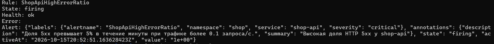

[Вывод API правил Prometheus](evidence/alert-firing.txt) и [лог генератора ошибок](evidence/alert-errors-generator.txt).

Дашборд **Shop — лабораторная 4: SLA и ресурсы**, UID `shop-lab4`, добавлен отдельным [ConfigMap-шаблоном](../shop-chart/templates/lab4-dashboard.yaml). Метка `grafana_dashboard: "1"` позволяет sidecar Grafana загрузить JSON. Используется datasource UID `prometheus`; namespace и release задаются переменными. Старый дашборд лабораторной 3 сохранён.

Панели показывают HTTP p95/5xx/RPS, обработку worker, CPU, throttling, память, фазы batch, готовые реплики и активные алерты. Панель `ALERTS` с `No data` означает отсутствие рядов, соответствующих запросу, а не автоматически подтверждённую исправность всей системы. Скриншоты 34–36 и 40–42 показывают дашборд в двух итоговых опытах. На части снимков включён перевод браузера, поэтому `batch` отображается как «партия»/«пакет»; имена Kubernetes-объектов в логах не изменялись.

## Восстановление и границы результата

После экспериментов применён обычный профиль `lab-4/values.yaml`, ревизия Helm 29: API 3/3, worker 6/6, batch 1/1, PostgreSQL healthy. Проверка kubelet показала `evictionSoft: None`, экспериментальный nodeSelector batch очищен. Оба варианта `helm lint` прошли в WSL.

При проверке после восстановления у живого batch ещё оставалась стратегия `Recreate`, хотя экспериментальный файл больше не подключался. Для возврата к RollingUpdate была предложена отдельная коррекция; подтверждения её выполнения в сохранённых материалах нет. Повторная проверка:

```bash
kubectl --context kind-labs get deployment shop-batch -n shop \
  -o jsonpath='Strategy: {.spec.strategy.type}{"\n"}NodeSelector: {.spec.template.spec.nodeSelector}{"\n"}'
```

Результаты относятся к двухнодовому лабораторному kind-стенду и нагрузке 5 заказов/с. Preemption выполнен API; отдельный опыт preemption PostgreSQL не проводился. Memory eviction получен при временно поднятом пороге kubelet. PDB PostgreSQL обеспечен оператором CNPG. Рекомендаций KRR для PostgreSQL в отчёте нет, а CPU API и профиль batch приняты с отклонениями от рекомендаций. Эти ограничения не скрываются за успешными нагрузочными тестами.

Практический вывод: при выбранных настройках второстепенный batch теряет доступность первым, а оформление и последующая обработка заказов сохраняются. Критерии k6 выполнены в обоих итоговых прогонах; перенос чисел ресурсов на другой стенд требует новых измерений.
