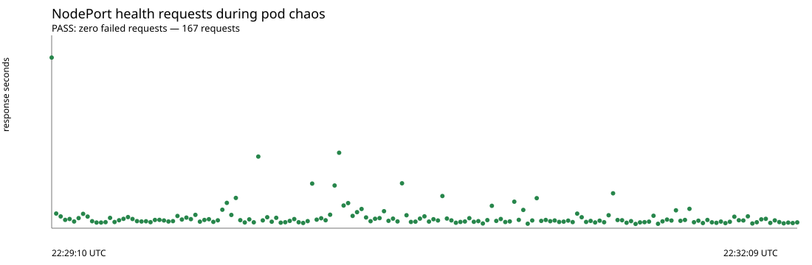

# Лабораторная 5 — Zero-trust сеть для shop

Пошаговая инструкция и воспроизводимая последовательность экспериментов для
этого репозитория. Фактические результаты выполненного прогона приведены в
отдельном [отчёте](report.md).
Цель работы — развернуть сервис `shop` в отдельном kind-кластере, исследовать
маршрутизацию Kubernetes Service, применить zero-trust NetworkPolicy и проверить
сетевые потоки через Cilium/Hubble и Prometheus.

Шаблоны политики находятся в
[`shop-chart/templates/networkpolicy.yaml`](../shop-chart/templates/networkpolicy.yaml),
значения для lab5 — в [`shop-chart/values-lab5.yaml`](../shop-chart/values-lab5.yaml).
Отдельный кластер нужен потому, что CNI нельзя безопасно заменить на уже работающем
kindnet-кластере. Выбран Cilium: он применяет Kubernetes NetworkPolicy и даёт Hubble
для наблюдения разрешённых и отброшенных потоков.

В каждой части приведены цель, команды проверки и ожидаемое место для фактического
результата. Ожидаемые результаты не подменяют измерения: сохраните собственные
выводы команд и скриншоты там, где они требуются.

## Подготовка. Требования и установка

Нужны Docker Engine, kind, kubectl, Helm, Cilium CLI, curl, Python 3 и `shuf`.
Ниже приведена установка для Ubuntu 22.04/24.04 (Linux, архитектуры amd64 или
arm64). Для других дистрибутивов используйте соответствующий пакетный менеджер;
команды установки kind и Cilium CLI для Linux остаются такими же.

### Установка на Ubuntu

Установите базовые пакеты. `shuf` входит в `coreutils` и обычно уже установлен:

```bash
sudo apt-get update
sudo apt-get install -y ca-certificates curl gnupg python3 coreutils
```

Установите Docker Engine из официального репозитория Docker:

```bash
sudo install -m 0755 -d /etc/apt/keyrings
curl -fsSL https://download.docker.com/linux/ubuntu/gpg \
  | sudo gpg --dearmor -o /etc/apt/keyrings/docker.gpg
sudo chmod a+r /etc/apt/keyrings/docker.gpg
echo \
  "deb [arch=$(dpkg --print-architecture) signed-by=/etc/apt/keyrings/docker.gpg] https://download.docker.com/linux/ubuntu \
  $(. /etc/os-release && echo "$VERSION_CODENAME") stable" \
  | sudo tee /etc/apt/sources.list.d/docker.list > /dev/null
sudo apt-get update
sudo apt-get install -y docker-ce docker-ce-cli containerd.io \
  docker-buildx-plugin docker-compose-plugin
```

Чтобы запускать Docker без `sudo`, добавьте своего пользователя в группу `docker`,
затем выйдите из системы и войдите снова. Членство в этой группе даёт практически
эквивалент root-доступа к машине; если это нежелательно, оставьте запуск через
`sudo docker`.

```bash
sudo usermod -aG docker "$USER"
```

Установите `kubectl` версии `v1.32.2` (совпадает с Kubernetes-версией по умолчанию
в kind `v0.27.0`) и `kind` версии `v0.27.0`. Переменная архитектуры ниже подходит
для amd64 и arm64:

```bash
ARCH="$(dpkg --print-architecture)"
KUBECTL_VERSION="v1.32.2"
curl -fsSLO "https://dl.k8s.io/release/${KUBECTL_VERSION}/bin/linux/${ARCH}/kubectl"
curl -fsSLO "https://dl.k8s.io/release/${KUBECTL_VERSION}/bin/linux/${ARCH}/kubectl.sha256"
echo "$(cat kubectl.sha256)  kubectl" | sha256sum --check
sudo install -o root -g root -m 0755 kubectl /usr/local/bin/kubectl
rm kubectl kubectl.sha256

curl -fsSLo kind "https://kind.sigs.k8s.io/dl/v0.27.0/kind-linux-${ARCH}"
sudo install -o root -g root -m 0755 kind /usr/local/bin/kind
rm kind
```

Установите Helm из официального apt-репозитория:

```bash
curl -fsSL https://baltocdn.com/helm/signing.asc \
  | sudo gpg --dearmor -o /usr/share/keyrings/helm.gpg
sudo apt-get install -y apt-transport-https
echo "deb [arch=$(dpkg --print-architecture) signed-by=/usr/share/keyrings/helm.gpg] https://baltocdn.com/helm/stable/debian/ all main" \
  | sudo tee /etc/apt/sources.list.d/helm-stable-debian.list
sudo apt-get update
sudo apt-get install -y helm
```

Установите Cilium CLI. Версия CLI берётся из официального файла стабильного
релиза; сама лабораторная устанавливает Cilium `1.17.4` ниже:

```bash
case "$(dpkg --print-architecture)" in
  amd64|arm64) CLI_ARCH="$(dpkg --print-architecture)" ;;
  *) echo "Поддерживаются только amd64 и arm64" >&2; exit 1 ;;
esac
CILIUM_CLI_VERSION="$(curl -fsSL https://raw.githubusercontent.com/cilium/cilium-cli/main/stable.txt)"
curl -fsSLO "https://github.com/cilium/cilium-cli/releases/download/${CILIUM_CLI_VERSION}/cilium-linux-${CLI_ARCH}.tar.gz"
curl -fsSLO "https://github.com/cilium/cilium-cli/releases/download/${CILIUM_CLI_VERSION}/cilium-linux-${CLI_ARCH}.tar.gz.sha256sum"
sha256sum --check "cilium-linux-${CLI_ARCH}.tar.gz.sha256sum"
sudo tar -xzf "cilium-linux-${CLI_ARCH}.tar.gz" -C /usr/local/bin
rm "cilium-linux-${CLI_ARCH}.tar.gz" "cilium-linux-${CLI_ARCH}.tar.gz.sha256sum"
```

Установите Hubble CLI версии `v1.17.5`, совместимой с Cilium `1.17.4`:

```bash
HUBBLE_VERSION="v1.17.5"
HUBBLE_ARCH="$(dpkg --print-architecture)"
curl -fsSLO "https://github.com/cilium/hubble/releases/download/${HUBBLE_VERSION}/hubble-linux-${HUBBLE_ARCH}.tar.gz"
curl -fsSLO "https://github.com/cilium/hubble/releases/download/${HUBBLE_VERSION}/hubble-linux-${HUBBLE_ARCH}.tar.gz.sha256sum"
sha256sum --check "hubble-linux-${HUBBLE_ARCH}.tar.gz.sha256sum"
sudo tar -xzf "hubble-linux-${HUBBLE_ARCH}.tar.gz" -C /usr/local/bin hubble
rm "hubble-linux-${HUBBLE_ARCH}.tar.gz" "hubble-linux-${HUBBLE_ARCH}.tar.gz.sha256sum"
```

Проверьте установку и доступ Docker, открыв новую сессию терминала после добавления
в группу `docker`:

```bash
docker version
kind version
kubectl version --client
helm version
cilium version --client
hubble version
curl --version
python3 --version
shuf --version
```

Проверьте текущие контексты, чтобы не удалить и не менять кластер предыдущей
работы:

```bash
kubectl config get-contexts
kind get clusters
```

Создайте отдельный кластер lab5 с двумя worker-нодами:

```bash
kind create cluster --config infra/kind-lab5.yaml --wait 5m
kubectl --context kind-lab5 get nodes -o wide
```

В отчёт: вывод `kubectl get nodes -o wide`, обоснование выбора Cilium.
`kubeProxyReplacement` выключен намеренно — в стенде остаётся kube-proxy, поэтому
отдельно наблюдаем стандартный Service dataplane.

## Часть 1. Развёртывание стенда

В новом кластере нужны Prometheus CRD до установки Cilium, чтобы Cilium мог
создать ServiceMonitor. Сначала установите тот же Prometheus/Grafana release из
лабораторной 2 без ожидания Pod’ов (CNI пока ещё не установлен):

```bash
helm repo add prometheus-community https://prometheus-community.github.io/helm-charts
helm repo add cloudnative-pg https://cloudnative-pg.github.io/charts
helm repo add jaegertracing https://jaegertracing.github.io/helm-charts
helm repo update

helm upgrade --install kube-prometheus prometheus-community/kube-prometheus-stack \
  --kube-context kind-lab5 --namespace monitoring --create-namespace \
  -f api/prometheus/values.yaml --wait=false
kubectl --context kind-lab5 wait \
  --for=condition=Established crd/servicemonitors.monitoring.coreos.com \
  --timeout=2m
kubectl --context kind-lab5 wait \
  --for=condition=Established crd/prometheusrules.monitoring.coreos.com \
  --timeout=2m
```

Теперь установите Cilium с указанными параметрами, дождитесь `cilium status --wait`,
затем дождитесь Prometheus/Grafana и установите CloudNativePG:

```bash
cilium install --version 1.17.4 \
  --namespace kube-system \
  --helm-values infra/cilium-lab5-values.yaml
cilium status --wait
kubectl --context kind-lab5 -n kube-system get pods -o wide

helm upgrade --install kube-prometheus prometheus-community/kube-prometheus-stack \
  --kube-context kind-lab5 --namespace monitoring \
  -f api/prometheus/values.yaml --wait --timeout 10m

helm upgrade --install cnpg cloudnative-pg/cloudnative-pg \
  --kube-context kind-lab5 --namespace cnpg-system --create-namespace \
  --version 0.29.1 -f infra/cnpg-operator-values.yaml \
  --wait --timeout 5m

helm upgrade --install jaeger jaegertracing/jaeger \
  --kube-context kind-lab5 --namespace monitoring \
  -f api/jaeger/values-jaeger.yaml --wait --timeout 5m
```

Проверьте Docker-сеть kind, чтобы записать адреса kind-узлов и подсеть стенда:

```bash
docker network inspect kind \
  --format '{{range .IPAM.Config}}{{println .Subnet}}{{end}}'
```

Источник NodePort-трафика определяйте по Hubble, а не только по Docker bridge:
в kind адрес источника может быть преобразован kube-proxy/Cilium. В этом стенде
поток пришёл от `10.244.0.37` и классифицировался Cilium как `world`; для внешнего
входа к API используется CiliumNetworkPolicy, разрешающая entity `world` только
на TCP-порт API. В kind-профиле host-порт привязан к `127.0.0.1`. Не переносите
это разрешение без изменений в публичный кластер: там ограничьте источник доверенной
подсетью или соответствующим внешним сетевым контролем.

CloudNativePG's instance manager also needs TCP `6443` to the Kubernetes API.
The lab overlay permits this only through Cilium's `kube-apiserver` entity and
TCP port `6443`. Without that Cilium-specific exception, Hubble records
continuous PostgreSQL-to-API drops even while the database appears Ready.

Соберите образы из исходников и загрузите их во все узлы:

```bash
docker build -t docker.io/library/shop-api:v2 \
  -f shop-services/api/Dockerfile ./shop-services
docker build -t docker.io/library/shop-worker:v1 \
  -f shop-services/worker/Dockerfile ./shop-services
kind load docker-image docker.io/library/shop-api:v2 \
  docker.io/library/shop-worker:v1 --name lab5
```

Установите базовый чарт без NetworkPolicy, но с NodePort; политики включаются
после исходного исследования сети:

```bash
helm upgrade --install shop ./shop-chart \
  --kube-context kind-lab5 --namespace shop --create-namespace \
  -f shop-chart/values.yaml \
  --set api.service.type=NodePort \
  --set api.service.nodePort=30080 \
  --wait --timeout 10m

kubectl --context kind-lab5 -n shop get pods,svc,endpointslices -o wide
kubectl --context kind-lab5 -n shop get cluster shop-postgres
kubectl --context kind-lab5 -n shop wait \
  --for=condition=Ready cluster/shop-postgres --timeout=5m
kubectl --context kind-lab5 -n shop get secret shop-postgres-app
```

**Результат и доказательства.** Зафиксируйте `helm list -A`, список
Pods/Services/EndpointSlices, состояние `shop-postgres` и ответы
`curl -i http://127.0.0.1:18080/health` и
`curl -i http://127.0.0.1:18080/ready`. Не помещайте пароли Secret в отчёт.

## Часть 2. Исследование исходной сети и Service

До включения NetworkPolicy зафиксируйте исходную конфигурацию CNI, kube-proxy,
адреса Pod’ов и endpoints Service:

```bash
kubectl --context kind-lab5 -n kube-system get ds
kubectl --context kind-lab5 -n kube-system get configmap kube-proxy -o yaml
kubectl --context kind-lab5 -n shop get pods -o wide
kubectl --context kind-lab5 -n shop get endpointslices \
  -l kubernetes.io/service-name=shop-api -o wide
```

Приложение собрано в `FROM scratch`, поэтому в нём нет `ip`, `cat`, `ping`, `curl`
и shell. Используйте временные диагностические Pod’ы до включения политик. Для
netshoot существует тег `v0.13` (тег `v0.13.0` отсутствует):

```bash
kubectl --context kind-lab5 -n shop run net-debug-a \
  --image=nicolaka/netshoot:v0.13 --restart=Never \
  --overrides='{"apiVersion":"v1","spec":{"nodeName":"lab5-worker"}}' -- sleep 3600
kubectl --context kind-lab5 -n shop run net-debug-b \
  --image=nicolaka/netshoot:v0.13 --restart=Never \
  --overrides='{"apiVersion":"v1","spec":{"nodeName":"lab5-worker2"}}' -- sleep 3600
kubectl --context kind-lab5 -n shop wait --for=condition=Ready pod/net-debug-a pod/net-debug-b --timeout=2m
kubectl --context kind-lab5 -n shop get pods -o wide
kubectl --context kind-lab5 -n shop exec net-debug-a -- ip addr
kubectl --context kind-lab5 -n shop exec net-debug-a -- cat /etc/resolv.conf
kubectl --context kind-lab5 -n shop exec net-debug-a -- getent hosts shop-api
NET_DEBUG_B_IP=$(kubectl --context kind-lab5 -n shop get pod net-debug-b -o jsonpath='{.status.podIP}')
kubectl --context kind-lab5 -n shop exec net-debug-a -- ping -c 3 "$NET_DEBUG_B_IP"
```

**Результат и доказательства.** Укажите Pod IP на разных нодах, DNS-ответ сервиса
и краткую схему Service →
EndpointSlice → kube-proxy → выбранный pod. На kind-хосте можно дополнительно
показать veth-пару: `iflink` внутри pod network namespace указывает индекс peer
интерфейса на ноде. Сопоставьте выводы:

```bash
kubectl --context kind-lab5 -n shop exec net-debug-a -- cat /sys/class/net/eth0/iflink
docker exec lab5-worker ip -o link
```

Названия интерфейсов и доступность namespace зависят от версии Docker/kind.
Зафиксируйте, если инструмент недоступен, не подменяя это предположением.

### Проверка устойчивости Service под нагрузкой

Создайте client pod, помеченный как доверенный клиент; его запросы идут к Service
по DNS-имени, не к pod IP:

```bash
kubectl --context kind-lab5 -n shop run lab5-client \
  --image=curlimages/curl:8.12.1 --restart=Never \
  --labels='app.kubernetes.io/name=shop,app.kubernetes.io/instance=shop,app.kubernetes.io/component=client' \
  --command -- sleep 3600
kubectl --context kind-lab5 -n shop wait --for=condition=Ready pod/lab5-client --timeout=2m
kubectl --context kind-lab5 -n shop exec lab5-client -- \
  curl -fsS http://shop-api:8080/health
```

Для внешней NodePort-нагрузки и артефакта для графика запустите один терминал:

```bash
DURATION_SECONDS=180 OUTPUT=lab-5/evidence/load-test.csv \
  bash scripts/lab5/load-test.sh
```

Во втором терминале одновременно запустите ограниченный хаос-тест:

```bash
CONFIRM_CHAOS=YES MAX_DELETIONS=20 INTERVAL_SECONDS=5 \
  bash scripts/lab5/chaos-pods.sh
```

Постройте SVG по собранным данным:

```bash
python3 scripts/lab5/plot-load-test.py \
  lab-5/evidence/load-test.csv lab-5/evidence/load-test.svg
```

**Результат эксперимента.** В сохранённом CSV находятся 167 успешных ответов HTTP
200 и 0 неуспешных запросов. График построен по этому набору:



Сохраните CSV, график, число удалённых Pod’ов и их новые IP для своего прогона.
Различайте проверки: внешний скрипт обращается к NodePort,
а client pod — к `shop-api` через CoreDNS. DNS разрешает имя Service в ClusterIP;
EndpointSlice отражает готовые pod endpoints; kube-proxy направляет поток на endpoint.
DNS не меняет адрес при каждом пересоздании pod’а, потому что Service сохраняет
ClusterIP. NodePort даёт порт на узлах; LoadBalancer ожидает внешний LB-интегратор;
headless Service не выделяет ClusterIP и возвращает адреса pod’ов через DNS.
В iptables и IPVS меняется механизм реализации Service forwarding, но не эта модель
обновления endpoints.

## Часть 3. Zero-trust NetworkPolicy и проверка матрицы

Перед применением политики удалите диагностические pod’ы, чтобы не оставить
посторонние источники в namespace:

```bash
kubectl --context kind-lab5 -n shop delete pod net-debug-a net-debug-b
helm upgrade --install shop ./shop-chart \
  --kube-context kind-lab5 --namespace shop \
  -f shop-chart/values-lab5.yaml --wait --timeout 10m
kubectl --context kind-lab5 -n shop get networkpolicy
```

NetworkPolicy включены только overlay-файлом lab5. Политика default-deny выбирает
все pod’ы namespace `shop`; точечные allow правила открывают DNS, клиент → API,
API/worker → PostgreSQL, мониторинг → метрики и OTLP → Jaeger. PostgreSQL получает
вход только от API/worker, своих экземпляров, CNPG operator и мониторинга на
указанных портах.

Создайте недоверенный Pod. Увеличенный срок `sleep` позволяет выполнить диагностику
без ошибки `cannot exec into a container in a completed pod`:

```bash
kubectl --context kind-lab5 -n shop run lab5-outsider \
  --image=busybox:1.36 --restart=Never \
  --labels='app.kubernetes.io/name=shop,app.kubernetes.io/instance=shop,app.kubernetes.io/component=outsider' \
  --command -- sleep 3600
kubectl --context kind-lab5 -n shop wait --for=condition=Ready pod/lab5-outsider --timeout=2m
```

Проверьте клиентский DNS → Service → API путь:

```bash
kubectl --context kind-lab5 -n shop exec lab5-client -- \
  curl -fsS --max-time 3 http://shop-api:8080/health
```

Приложенческие образы могут не содержать диагностических утилит. Для API и worker
проверяйте их собственное соединение с БД через `/ready`, используя port-forward
для локального теста. Каждый port-forward держите в отдельном терминале:

```bash
kubectl --context kind-lab5 -n shop port-forward svc/shop-api 18081:8080
# Во втором терминале:
curl -i http://127.0.0.1:18081/ready
kubectl --context kind-lab5 -n shop port-forward svc/shop-worker 18082:8080
# Во втором терминале:
curl -i http://127.0.0.1:18082/ready
```

PostgreSQL принимает raw TCP, это не HTTP endpoint. Для реального запроса к БД
создайте заказ через API и дождитесь обработки worker:

```bash
curl -i -X POST http://127.0.0.1:18080/order \
  -H 'Content-Type: application/json' \
  -d '{"item":"lab5-matrix","quantity":1}'
curl -s http://127.0.0.1:18080/orders
```

Недоверенный `lab5-outsider` не имеет egress-разрешения. Узнайте адреса PostgreSQL
pod и API Service; попытки `nc` от outsider должны завершиться неуспешно.
Busybox обычно содержит `nc`; проверьте код возврата, чтобы не спутать отсутствие
утилиты с сетевым запретом:

```bash
POSTGRES_POD_IP=$(kubectl --context kind-lab5 -n shop get pods \
  -l cnpg.io/cluster=shop-postgres -o jsonpath='{.items[0].status.podIP}')
API_CLUSTER_IP=$(kubectl --context kind-lab5 -n shop get svc shop-api -o jsonpath='{.spec.clusterIP}')
kubectl --context kind-lab5 -n shop exec lab5-outsider -- nc -z -w 2 "$POSTGRES_POD_IP" 5432
kubectl --context kind-lab5 -n shop exec lab5-outsider -- nc -z -w 2 "$API_CLUSTER_IP" 8080
```

Ожидаемая матрица. Заполните столбец «Фактический результат» своими наблюдениями;
ожидаемое значение само по себе не является доказательством:

| Источник | Назначение | Ожидается | Фактический результат |
|---|---|---|---|
| lab5-client | shop-api:8080 | Разрешено | |
| shop-api | PostgreSQL:5432 | Разрешено | |
| shop-worker | PostgreSQL:5432 | Разрешено | |
| lab5-outsider | PostgreSQL:5432 | Запрещено | |
| lab5-outsider | shop-api:8080 | Запрещено | |
| shop-api, shop-worker | CoreDNS:53 UDP/TCP | Разрешено | |
| Prometheus | API/worker metrics:8080 | Разрешено | |
| прочие pod’ы | API/worker/PostgreSQL | Запрещено | |

**Результат и доказательства.** Сохраните фактические команды, выводы и заполненную
матрицу. При проверке outsider’а Pod должен оставаться `Running`; завершившийся
Pod нужно создать заново перед `exec`. Удалите временные Pod’ы после проверки:

```bash
kubectl --context kind-lab5 -n shop delete pod \
  lab5-client lab5-outsider lab5-dns-probe net-debug-a net-debug-b \
  --ignore-not-found
```

## Часть 4. Диагностика скрытой поломки

Скрипт случайно выбирает один из четырёх вариантов: отключить DNS, убрать
разрешение PostgreSQL, испортить порт БД или закрыть внешний вход к API. Он
сохраняет overlay в `lab-5/evidence/fault-values.yaml`, применяет его через Helm
и перезапускает API, чтобы новое соединение использовало изменённую политику:

```bash
CONFIRM_FAULT=YES bash scripts/lab5/inject-fault.sh
```

Перед чтением generated overlay сначала зафиксируйте симптом и найдите drop:

```bash
curl -i --max-time 5 http://127.0.0.1:18080/ready
```

В отдельном терминале откройте Hubble Relay port-forward, затем наблюдайте потоки:

```bash
cilium hubble port-forward --context kind-lab5 --port-forward 4245
```

```bash
hubble observe --server localhost:4245 --verdict DROPPED --since 5m
hubble observe --server localhost:4245 --namespace shop --since 5m
```

Если NodePort заблокирован, проверьте source, destination, порт и verdict потока.
Для kind-кластера не добавляйте произвольную Docker-подсеть в `ipBlock`: Cilium может
видеть источник NodePort после трансляции как `world`. В этом чарте внешний вход
разрешается только через CiliumNetworkPolicy и только к API-порту; внутрикластерные
Pod'ы по-прежнему ограничены обычными NetworkPolicy.

Для визуальной карты Hubble откройте ещё один терминал и запустите:

```bash
cilium hubble ui
```

**Диагностический ход в отчёте:** симптом → source/destination/port/вердикт из
Hubble → связанное правило/значение Helm → точечное исправление → повторная
проверка матрицы. После диагностики повторно примените базовый корректный overlay,
чтобы поломка не осталась в кластере:

```bash
helm upgrade --install shop ./shop-chart \
  --kube-context kind-lab5 --namespace shop \
  -f shop-chart/values-lab5.yaml --wait --timeout 10m
kubectl --context kind-lab5 -n shop rollout status deployment/shop-api
kubectl --context kind-lab5 -n shop get networkpolicy
```

Затем повторите `GET /ready`, запрос заказа и все проверки матрицы. Не считайте
успешный `helm upgrade` доказательством доступности: NetworkPolicy часто не
меняет Ready-статус контейнера.

## Часть 5. Метрики приложения и алерты

Helm-чарт создаёт ServiceMonitor для API/worker и PrometheusRule
[`shop-chart/templates/prometheusrule.yaml`](../shop-chart/templates/prometheusrule.yaml).
Сначала убедитесь, что targets доступны в Prometheus (Status → Targets), затем
проверьте запросы и метрики приложения:

```promql
sum(rate(http_requests_total{namespace="shop",service="shop-api"}[2m]))
sum(rate(http_request_duration_seconds_bucket{namespace="shop",service="shop-api"}[2m]))
sum(rate(worker_orders_processed_total{namespace="shop",service="shop-worker"}[2m]))
sum(increase(coredns_dns_responses_total{job="coredns"}[5m]))
```

В PrometheusRule определены `ShopTargetDown`, `ShopApiHighErrorRatio`,
`ShopNetworkPolicyDrops`, `ShopDNSFailures` и `ShopWorkerErrors`. Для проверки
алерта HTTP 5xx отправьте серию запросов `/fail`; для проверки DNS-метрики
сделайте запрос к несуществующему имени из доверенного client pod:

```bash
for i in $(seq 1 30); do curl -s -o /dev/null http://127.0.0.1:18080/fail; done
kubectl --context kind-lab5 -n shop exec lab5-client -- \
  curl -sS --max-time 4 http://does-not-exist.invalid
```

**Результат и доказательства.** Сохраните скриншот Prometheus Targets, графики
метрик приложения и фактическое состояние проверенных алертов. Не указывайте
`Firing`, если это не подтверждено Prometheus → Alerts или Prometheus API.
Ожидаемый `NXDOMAIN` увеличивает CoreDNS-счётчик, но сам по себе не считается
ошибкой `SERVFAIL` и не должен включать `ShopDNSFailures`.

## Часть 6. Метрики Cilium и Hubble

Cilium/Hubble публикует flow, drop и TCP метрики; DNS-ответы и `rcode` собираются
с CoreDNS. Конфигурация сетевого мониторинга и ServiceMonitor заданы в
[`infra/cilium-lab5-values.yaml`](../infra/cilium-lab5-values.yaml). Проверьте
сетевые ряды через PromQL:

```promql
sum(rate(hubble_tcp_flags_total{source_namespace="shop",flags="SYN"}[2m]))
sum(increase(hubble_flows_processed_total{destination_namespace="shop"}[5m]))
sum(increase(hubble_flows_processed_total{verdict="DROPPED",source_namespace="shop"}[5m]))
  + sum(increase(hubble_flows_processed_total{verdict="DROPPED",destination_namespace="shop"}[5m]))
sum(increase(coredns_dns_responses_total{job="coredns"}[5m]))
```

Для диагностики конкретных потоков используйте Hubble CLI. Команды ниже
показывают отброшенные потоки и все потоки namespace `shop`:

```bash
hubble observe --server localhost:4245 --verdict DROPPED --since 5m
hubble observe --server localhost:4245 --namespace shop --since 5m
cilium hubble ui
```

**Результат и доказательства.** В отчёте приведите поток с фактическим verdict и
укажите source, destination и порт. Для запрещённого соединения сохраните строки
`DROPPED`; для разрешённого — `FORWARDED`. Не подменяйте реальный вывод примером.

## Часть 7. Мониторинг сети

Grafana dashboard [`shop-chart/dashboards/shop.json`](../shop-chart/dashboards/shop.json)
содержит панели API/worker и Hubble: потоки по verdict, drop, DNS responses по
RCODE и TCP SYN. Определите имена Service и запустите каждый `port-forward` в
отдельном терминале:

```bash
kubectl --context kind-lab5 -n monitoring get svc
kubectl --context kind-lab5 -n monitoring port-forward \
  svc/kube-prometheus-kube-prome-prometheus 9090:9090
kubectl --context kind-lab5 -n monitoring port-forward \
  svc/kube-prometheus-grafana 3000:80
```

Откройте `http://localhost:9090` и `http://localhost:3000`. Если имена Service
в вашем релизе отличаются, подставьте результаты `kubectl get svc`. Импортируйте
dashboard в Grafana, установите временной интервал эксперимента и сохраните
скриншоты графиков и Hubble flow в `lab-5/evidence/`. Скриншоты должны показывать
фактические данные вашего кластера.

В качестве примера уже сохранённого прогона NodePort доступны
[`evidence/load-test.csv`](evidence/load-test.csv) и
[`evidence/load-test.svg`](evidence/load-test.svg): CSV содержит 167 ответов HTTP
200 и 0 ошибок. Эти артефакты не заменяют скриншоты Prometheus/Grafana и Hubble
для текущего запуска.

## Итоговый комплект артефактов отчёта

- Кластер: `kubectl get nodes -o wide`, Cilium status и режим kube-proxy.
- Исходная сеть: Pod IP и ноды, DNS Service lookup, EndpointSlice.
- Устойчивость Service: CSV, SVG, число запросов/ошибок и сведения об удалённых Pod’ах.
- Политики: `kubectl get networkpolicy -n shop -o yaml` и заполненная матрица.
- Поломка: симптом, Hubble drop с парами адресов/портом, причина и повторная матрица.
- Мониторинг: Prometheus targets, фактические метрики, скриншоты Grafana/Hubble и
  состояния проверенных алертов.
- Перед сдачей удалите временные Pod’ы и восстановите корректный values overlay.
