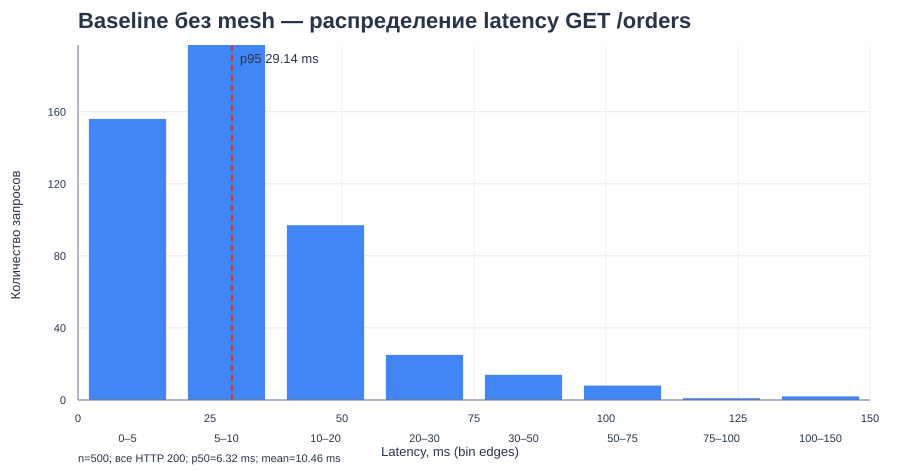
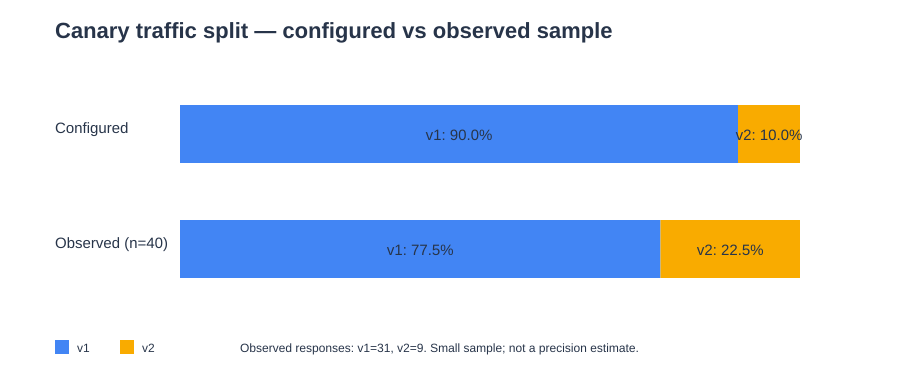

# Лабораторная работа 6 — итоговый отчёт

**Тема:** Service Mesh и автоматизация канареечного релиза  
**Дата эксперимента:** 25 октября 2026 г.  
**Результат:** выполнена реализация API v1/v2, mesh-инъекция и canary routing; некоторые экспериментальные критерии подтверждены частично, что отдельно отмечено ниже.

## Цель работы

Развернуть версии API v1 и v2, направлять между ними трафик через Gateway API
`HTTPRoute`, включить Linkerd для API и тестового клиента, проверить retry для
идемпотентного `GET /orders`, подготовить автоматический canary gate и сравнить
работу приложения до и после включения mesh.

## Среда и оговорки эксперимента

Отдельный кластер `kind-lab6` в этой среде не использовался. Эксперимент проведён
в существующем контексте `kind-lab5`, в изолированном namespace `lab6`; установка
не меняла workloads namespace `shop`. Prometheus/Grafana и Linkerd использовались
из уже работающей инфраструктуры кластера.

Control plane Linkerd запускался с образом `cr.l5d.io/linkerd/controller:edge-26.10.1`;
в mesh-Pod также присутствовал Linkerd proxy. Версию CLI зафиксировать не удалось:
команда `linkerd` на хосте отсутствовала. Поэтому здесь указана версия образа
control plane, а не непроверенная версия CLI.

## Реализованное решение

1. В API добавлены `GET /version`, переменная `API_VERSION` и управляемые
   fault-injection режимы: `FAIL=true` для отказа v2 на `POST /order` и
   `FLAKY=true` для случайных ошибок v1 на `GET /orders`.
2. В Helm chart добавлены отдельные Deployment и Service для v1/v2,
   стабильный Service `shop-api`, Gateway API routes с весами 90/10 и
   маршрут retry, ограниченный `GET /orders`.
3. Linkerd injection включена для API v1/v2 и клиентского Pod. Postgres и worker
   оставлены вне mesh.
4. Добавлены Prometheus ServiceMonitor/PodMonitor, три Prometheus alert rules,
   конфигурация Grafana и Python-скрипт canary gate.
5. Для проверки собраны CSV с baseline-запросами, HTTP-коды клиента, фактические
   ответы `/version`, снимки Kubernetes-ресурсов и Prometheus rule status.

Основные исходные файлы: [API](../shop-services/api/main.go),
[fault injection](../shop-services/api/release.go),
[values лабораторной](../shop-chart/values-lab6.yaml),
[canary deployments](../shop-chart/templates/api-canary-deployments.yaml),
[canary routes](../shop-chart/templates/api-canary-routes.yaml),
[Prometheus alerts](../shop-chart/templates/canary-prometheusrule.yaml) и
[canary gate](../scripts/lab6/canary-gate.py).

## Результаты измерений

### Baseline без mesh

Для baseline выполнено 500 запросов `GET /orders` без mesh. Все ответы были
HTTP 200. Значения ниже взяты из сохранённого summary-файла, а исходные запросы
доступны в CSV.

| Метрика | Baseline без mesh |
|---|---:|
| Запросов | 500 |
| HTTP 200 / ошибки | 500 / 0 |
| p50 latency | 6.32 ms |
| p95 latency | 29.14 ms |
| Средняя latency | 10.46 ms |
| Длительность теста | 5.34 s |

### Проверка canary traffic split

В `HTTPRoute/shop-api` установлены веса v1=90 и v2=10. Маршрут имел условия
`Accepted=True` и `ResolvedRefs=True`. В сохранённом тестовом наборе из 40
ответов `GET /version` через стабильный `shop-api` получены 31 ответ v1 и 9
ответов v2:

| Версия | Вес в HTTPRoute | Ответов `/version` | Доля наблюдений |
|---|---:|---:|---:|
| v1 | 90% | 31 | 77.5% |
| v2 | 10% | 9 | 22.5% |

Результат подтверждает, что оба backend доступны через стабильный Service, но
эта небольшая выборка не подтверждает точность распределения 90/10: наблюдаемая
доля v2 заметно выше заданной. Для вывода о качестве распределения требуется
повторить тест с большим количеством независимых запросов и проверить, что
клиентские соединения не переиспользуются способом, влияющим на выбор backend.

### Retry и fault injection

Retry policy задана на отдельном HTTPRoute для `GET /orders`; в route указаны
аннотации `retry.linkerd.io/http: "5xx"`, `retry.linkerd.io/limit: "3"` и
`retry.linkerd.io/timeout: "1s"`. `POST /order` в retry-маршрут не включён.
Тестовый клиент был mesh-инъецирован и отправил 100 запросов `GET /orders`.

| Результат клиента | Количество |
|---|---:|
| HTTP 200 | 95 |
| HTTP 500 | 5 |
| Всего | 100 |

Таким образом, утверждать, что retry полностью скрыл ошибки backend, нельзя:
клиент всё ещё получил пять ответов 500. В Prometheus также выполнялся запрос
к метрике v1 5xx; за выбранное 10-минутное окно он вернул прирост около 70.25.
Это окно включает больше, чем только приведённый 100-запросный запуск, поэтому
эти цифры не следует напрямую сравнивать друг с другом. Результат retry —
**частично проверен, успешное маскирование всех ошибок не доказано**.

### Сравнение mesh / no-mesh и ресурсов

В рамках этой сессии достоверного набора измерений latency и CPU/memory для
mesh-варианта получить не удалось. `kubectl top` завершился сообщением
`Metrics API not available`; готового client-side latency summary для mesh
эксперимента также нет. Поэтому процентное изменение и стоимость sidecar не
рассчитывались.

**Место для итогового графика:** сравнить p50/p95 latency до и после mesh на
одинаковом endpoint, объёме запросов и длительности теста.

**Место для итогового графика:** сравнить суммарные CPU и memory одинакового
набора API Pod’ов до и после mesh, отдельно показав приложение и `linkerd-proxy`.
Не смешивать результаты разного количества реплик.

## Canary gate и автопилот

В `scripts/lab6/canary-gate.py` реализованы Prometheus-запросы, минимальный размер
выборки, решение о rollback при повышенном error ratio/p95 и постепенное
продвижение v2. Настройки по умолчанию: окно 2 минуты, минимум 20 запросов,
порог 5% ошибок, p95 до 200 ms, шаг продвижения 10%, два здоровых окна,
интервал опроса 15 секунд. Для этого развёртывания namespace должен быть задан
как `NAMESPACE=lab6` (скрипт по умолчанию использует `shop`).

Выполнены четыре unit-теста логики решений: недостаточная выборка не повышает
вес, высокая доля ошибок приводит к rollback, promotion требует несколько
здоровых окон и не превышает 100%. Все четыре теста прошли. Сквозной запуск
скрипта с реальным трафиком, автоматическое снятие веса v2 до 0% и последующее
продвижение v2 до 100% в этой сессии не подтверждены.

## Мониторинг и алерты

В Prometheus загружены три правила; API rules вернул для каждого `health=ok`,
ошибок выражений нет, текущее состояние — `inactive`.

| Alert | Уровень | Условие |
|---|---|---|
| `ShopCanaryHighErrorRate` | critical | 5xx > 5% при не менее 20 запросах за 2m; условие удерживается 1m |
| `ShopCanaryHighLatencyP95` | warning | p95 > 200 ms в течение 5m |
| `ShopLinkerdProxyNotReady` | critical | контейнер `linkerd-proxy` не ready в течение 1m |

`inactive` означает, что правила вычисляются, но в момент снимка условия не
срабатывали; это не является доказательством успешного искусственного
срабатывания каждого правила. Для финальной сдачи рекомендуется приложить
скриншоты панелей Grafana с временным диапазоном эксперимента и страницы
Prometheus Rules.

**Место для графика:** доля 5xx и p95 canary v2 во времени, с отметками включения
`FAIL=true`, момента rollback и изменения весов.

**Место для графика:** фактический трафик по версиям и значение `v2_weight` во
времени для сценария здорового продвижения.

## Проверки и верификация

- `python3 -m unittest scripts/lab6/test_canary_gate.py -v` — 4 теста прошли.
- `cd shop-services && go test ./...` — Go-тесты прошли.
- `HTTPRoute/shop-api`: `Accepted=True`, `ResolvedRefs=True`, backend weights 90/10.
- API v1/v2 и клиентский Pod — `2/2 Running`; PostgreSQL и worker были вне mesh.
- Prometheus обнаруживал метрики lab6; три alert rules имели `health=ok`.
- Повторяемый `/version` тест: 40 ответов, сохранены результаты по версиям.
- Retry-проба: 100 клиентских запросов, из них 95 HTTP 200 и 5 HTTP 500.

## Вывод

Реализованы и развернуты основные компоненты лабораторной: версии API,
mesh-инъекция, canary Services, Gateway API routing, мониторинговые правила и
код canary gate. Проверки подтвердили готовность routes и доступность обеих
версий. При этом доступные измерения не подтверждают точность 90/10 на малой
выборке; клиент retry-пробы получил 5% HTTP 500; сквозная автопромоция и
rollback не выполнены; сравнение производительности и ресурсов mesh/no-mesh
отсутствует.

Поэтому вывод об оправданности стоимости mesh пока делать нельзя. Чтобы
закрыть лабораторную количественно, необходимо повторить canary- и retry-тесты
на большей выборке, запустить gate end-to-end и включить Metrics API либо
собирать CPU/memory через Prometheus. Не следует подменять эти отсутствующие
измерения оценками или результатами из других запусков.

## Артефакты

### Данные и визуализации

- [Baseline CSV — 500 запросов](./evidence/baseline-no-mesh.csv)
- [Baseline summary](./evidence/baseline-no-mesh.summary.json)
- [График baseline latency](./evidence/baseline-latency.svg)
- [Сырые ответы canary `/version`](./evidence/route-split.txt)
- [Сводка canary traffic split](./evidence/route-split-summary.json)
- [График traffic split](./evidence/route-split.svg)
- [HTTP-коды retry-клиента](./evidence/retry-client-status.txt)
- [Сводка retry-теста](./evidence/retry-client-summary.json)

### Снимки кластера и мониторинга

- [HTTPRoute YAML и статусы](./evidence/httproutes.yaml)
- [Pod’ы и их готовность](./evidence/pods-mesh.txt)
- [Deployments и Services](./evidence/workloads-services.txt)
- [PrometheusRule YAML](./evidence/prometheusrule.yaml)
- [Runtime status Prometheus rules](./evidence/prometheus-rule-status.json)
- [ServiceMonitor и PodMonitor](./evidence/servicemonitors.yaml)
- [Список Prometheus rules](./evidence/prometheusrules-list.txt)
- [Образы API/mesh](./evidence/pod-images.txt)
- [Образы control plane Linkerd](./evidence/linkerd-version.txt)

### Исходники и тесты

- [API main](../shop-services/api/main.go)
- [Fault-injection middleware](../shop-services/api/release.go)
- [Тесты API версий и ошибок](../shop-services/api/release_test.go)
- [Canary chart values](../shop-chart/values-lab6.yaml)
- [Canary Deployments и client](../shop-chart/templates/api-canary-deployments.yaml)
- [Canary Services](../shop-chart/templates/api-canary-services.yaml)
- [HTTPRoutes](../shop-chart/templates/api-canary-routes.yaml)
- [Proxy ServiceMonitor](../shop-chart/templates/proxy-servicemonitor.yaml)
- [Canary Prometheus alerts](../shop-chart/templates/canary-prometheusrule.yaml)
- [Canary gate](../scripts/lab6/canary-gate.py)
- [Canary gate unit tests](../scripts/lab6/test_canary_gate.py)
